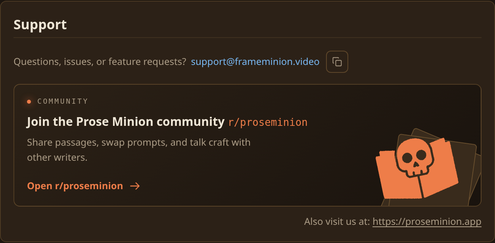
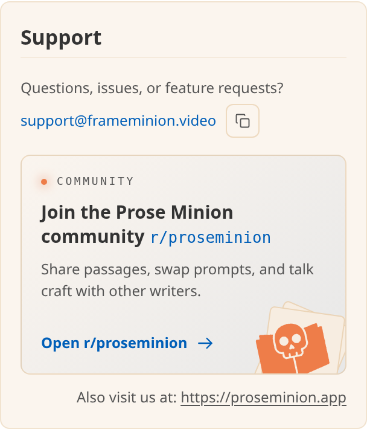

# Settings support and community tile

- Status: implemented; ready for review
- Priority: medium
- Motivation: make support and the writing community visible above the OpenRouter key, matching Frame Minion's support card with Prose Minion's identity.
- Scope: `SettingsOverlay.tsx`, a dedicated `SettingsSupport.tsx`, sidebar styles, and the existing settings hook/router for clipboard feedback. Reuses the bundled skull-book artwork also used by proseminion.app and the existing host clipboard route.
- Contact: `support@frameminion.video` (confirmed against Frame Minion's contact constants).
- Community: `https://www.reddit.com/r/proseminion/` (user-specified; Reddit returned HTTP 403 during verification).
- Completion: support section appears first; email/copy/community actions work; artwork ships locally; keyboard focus and narrow/light/dark layouts are checked; verification below is complete.

## Behavior

The Support section appears immediately above OpenRouter API Key. Its community card uses Prose Minion's coral palette, skull-book mark, and decorative manuscript pages. It follows the editor theme when enabled and preserves readable link colors when warm-dark is pinned over a light editor.

Copy uses the host clipboard. The overlay shows pending, acknowledged success, or failure with a retry; unrelated copy acknowledgements do not count as success. This feedback is transient and clears when settings closes or reopens. No new host message or persisted setting is introduced.

## Verification

- `npm run typecheck` — all three targets pass.
- `npm run lint` — no errors; repository warning policy unchanged.
- `npm run build` and bundle verification pass; the final sidebar bundle was rebuilt after the CSS compatibility/order fixes.
- Full Jest sweep: 871 of 874 suites passed initially. The three affected suites were rerun after fixing the CSS floor/import-order guards and refreshing the settings fixture; all pass. The focused settings/router run also passes (22 tests).
- Production-bundle browser check with a mocked host bridge: 280, 320, 420, 640, and 1024px widths across warm-dark, editor light/dark, and pinned warm-dark over a light editor (20 combinations). Checked placement, overflow, locally bundled artwork, contact URLs, copy success/error/reset, keyboard focus, reduced motion, and API-key save dispatch.
- Chromium 114 compatibility guard passes; the production CSS retains `-webkit-mask` for the declared VS Code 1.82 floor. Native Extension Development Host was not exercised.

## Screenshots

[Settings panel showing placement above the API key](screenshots/settings-panel.png)
