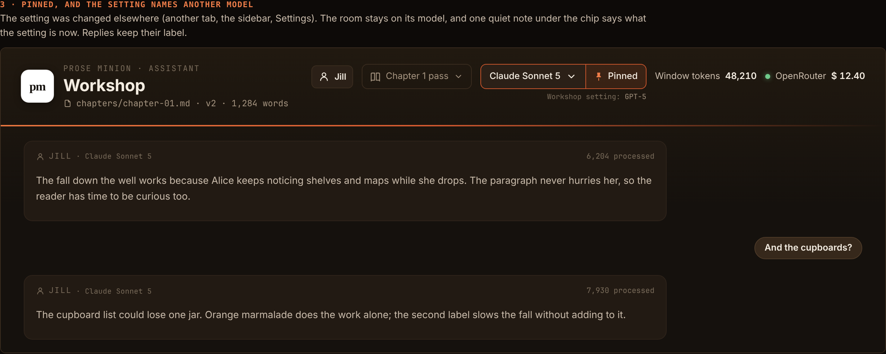
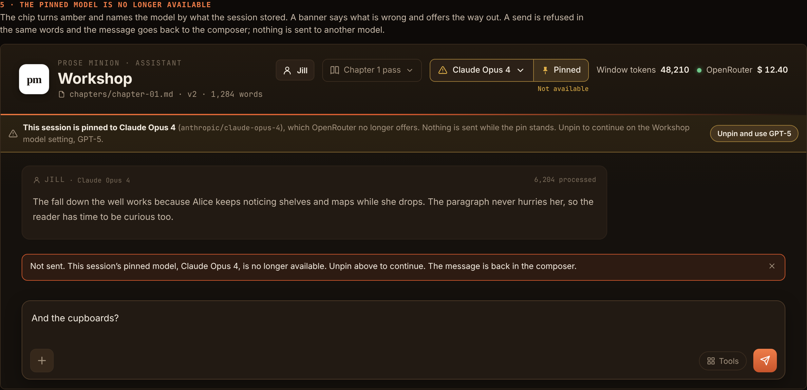

# Feature: Pin a Model to a Workshop Session

**Date Identified:** 2026-11-27
**Status:** Idea, decided: Okey took Ada's leans (2026-11-28). The on-screen design is drawn and waits for Okey's review ([design.md](design.md), 2026-11-28). Next: a short ADR on which model a run uses, and what follows it (window measure, prices, cache clock). Medium.
**Priority:** Medium
**Origin:** Okey, 2026-11-27

## In Okey's words

> Pin model in session. I use different models for different work. It'd be
> nice to have a "pin" button next to model. If the model is pinned, it
> doesn't switch if the setting changes elsewhere, and the pin would save to
> the session so the model survives. If the user unpins it switches back to
> the selected model in settings.

## What exists

- **Every room uses the Workshop's model setting** (the `assistant` scope,
  `proseMinion.assistantModel`). Change it anywhere, and every room's next
  reply switches.
- **The engine already takes a model per run.** `AgentRunOptions.model`
  overrides the engine's model, and the preflight measures against it too
  (`orchestration/AgentRunContracts.ts`). Craft Flags sends every call to the
  model it priced this way.
- **Personas have no model of their own.**
- **With tabs (2.17), rooms differ.** A pin lets each tab keep its own
  model: one for drafting, another for line work.

## Idea

1. **A pin beside the model name** in the room. Pinning stores
   `pinnedModel` on the session: optional and additive, with no
   `schemaVersion` bump.
2. **A pinned room sends every run to its pinned model.** That includes
   replies, guest replies, edit-offer answers and search deliveries, through
   `AgentRunOptions.model`. A settings change doesn't move it.
3. **Unpin** clears the field. The room follows the setting again from the
   next reply.
4. **Everything that names "the model" reads the room's effective model:**
   the window measure, the context meter, prices, the cache clock (today it
   compares against the setting) and the label.
5. **The pin follows the room.** It survives a reload, reopening the saved
   session, Rewind and Branch.
6. **A pinned model that's gone** (removed from OpenRouter, or no longer
   offered) is refused in host words, with Unpin offered. A pinned room is
   never quietly sent to another model.
7. **Styling:** a small pin toggle in the model label's row, needing mockups
   first. The parked [header model browser](../feature-workshop-header-model-browser/README.md)
   is the natural home for picking a model to pin.

## Decisions (Okey, 2026-11-28: Ada's leans, taken)

| # | Question | Decision |
|---|---|---|
| PM1 | Pin to the current model only, or pick any model to pin? | Pin the current one first. Picking comes with the model browser. |
| PM2 | Do Branch and Rewind keep the pin? | Yes; it's the room's. |
| PM3 | Do tool sidecars and helper tasks follow the pin? | No: they have their own scopes. Only the room's persona runs. |

## Design

[design.md](design.md) (2026-11-28) has the on-screen design: where the pin
lives, every state with its copy and accessible names, how each surface
reads the room's model, and eight open questions with a recommendation
each. It proposes no product code.

- **The pin is the right end of the header's model chip.** The chip names
  the room's model in place of the setting.
- **A note under the chip** says when the setting names another model.
- **Unpinning asks once,** only when it would change the next reply's model.

Every state, dark and light, at 1280, 880 and 520px:
[dark 1280](assets/sheet-dark-1280.png) ·
[dark 880](assets/sheet-dark-880.png) ·
[dark 520](assets/sheet-dark-520.png) ·
[light 1280](assets/sheet-light-1280.png) ·
[light 880](assets/sheet-light-880.png) ·
[light 520](assets/sheet-light-520.png).
The light sheets use a provisional palette: the Workshop is warm-dark only
today. The mockups' source is [`assets/pin-model.html`](assets/pin-model.html).

## Completion Criteria

- [ ] Pin stores the model on the session; every persona run in the room
      sends to it, and a settings change doesn't move it (tests).
- [ ] Unpin returns to the setting from the next reply (test).
- [ ] The window measure, prices, cache clock and label read the effective
      model (tests).
- [ ] The pin survives reload, reopen, Rewind and Branch; a session without
      it reads as today, from the pre-feature fixture (tests).
- [ ] A pinned model that's unavailable refuses in host words and offers
      Unpin (test).
- [ ] A help section explains pinning.

## Related

- [Session cache key](../feature-workshop-session-cache-key/README.md)
  (#37): a pin also keeps the cache warm, since a model change starts a new
  cache.

## Related Files

- `packages/core/src/infrastructure/api/orchestration/AgentRunContracts.ts` (`AgentRunOptions.model`)
- `packages/core/src/infrastructure/api/services/analysis/AssistantToolService.ts`
- `packages/core/src/application/services/workshop/WorkshopPersistedSession.ts`
- `packages/core/src/presentation/webview/WorkshopApp.tsx` (the cache clock's model check)
