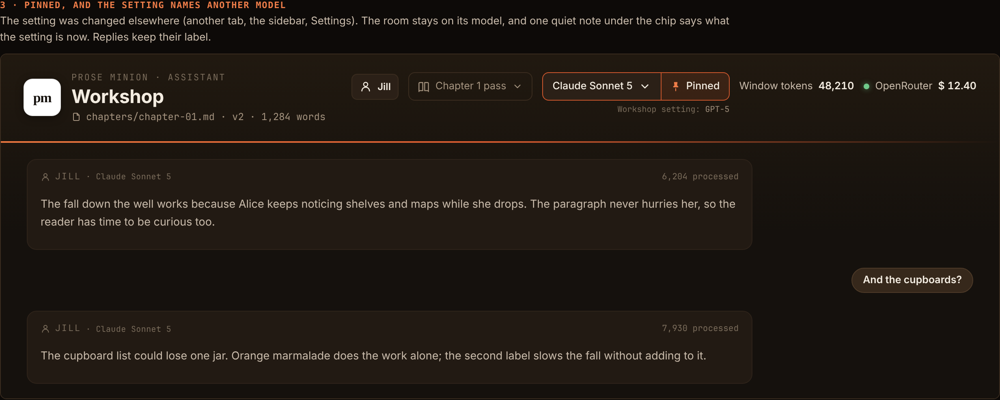
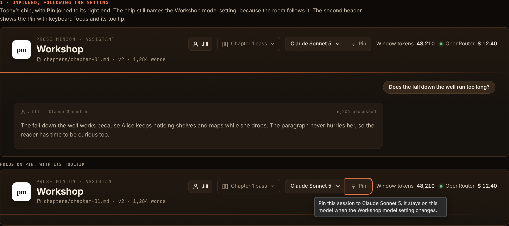
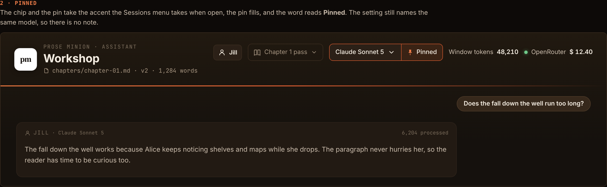
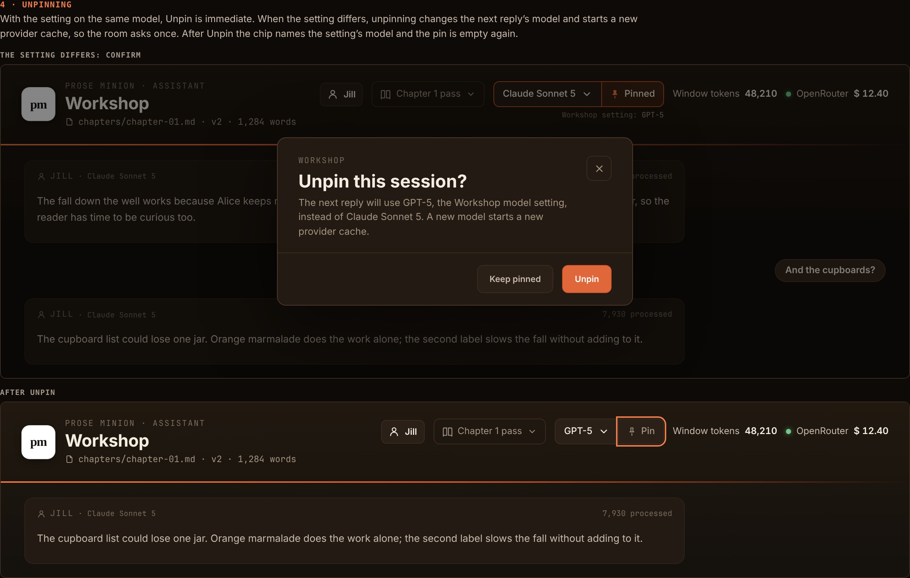
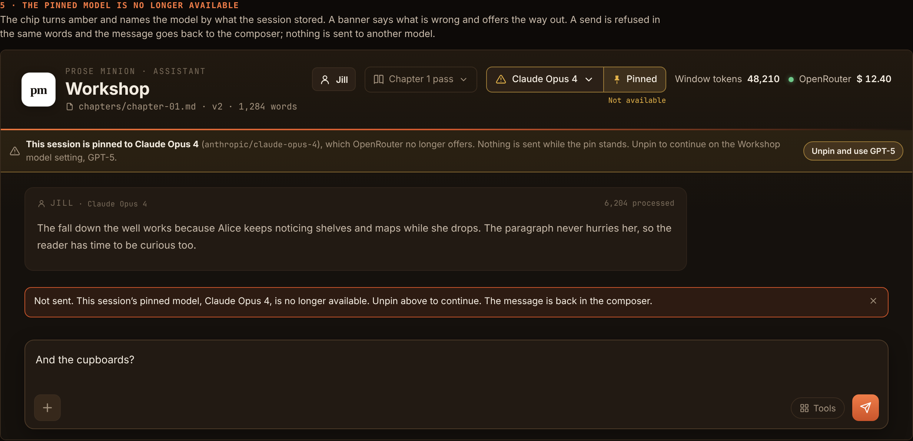
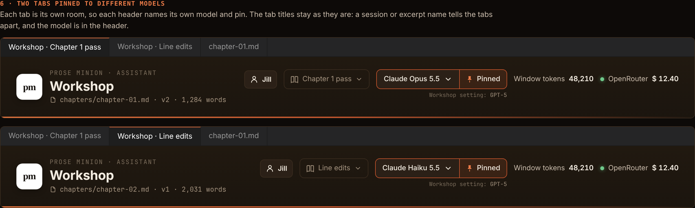
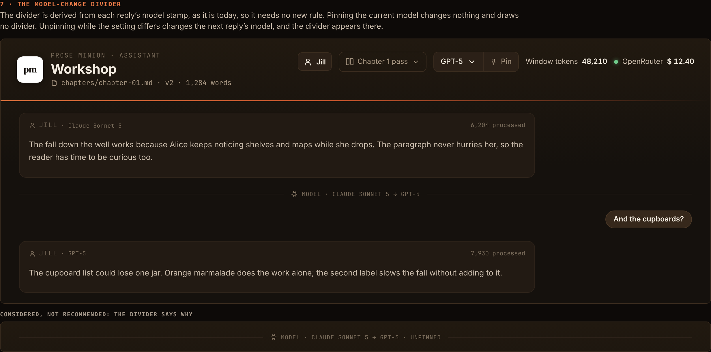
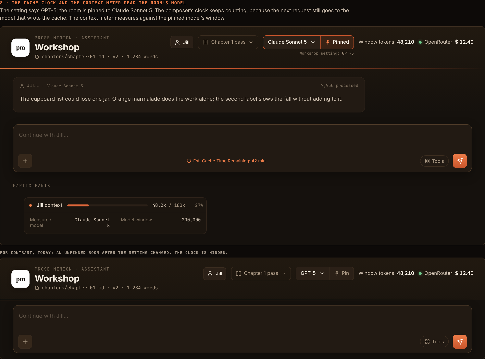

# Pin a Model to a Workshop Session: On-screen Design

**Date:** 2026-11-28
**Status:** Design proposed, for Okey's review. No product code.
**Feature:** [README](README.md) (#42), decisions PM1–PM3.
**Mockups:** [`assets/`](assets/), built on the webview's own stylesheets.

## Summary

- **The pin lives in the header, joined to the model chip.** The chip
  already shows a model there. It now names the room's model, and a **Pin**
  button sits on its right end.
- **Pinned,** the chip and pin take the accent border, the pin icon fills
  and the word reads **Pinned**.
- **When the setting names another model,** one small note under the chip
  says so: "Workshop setting: GPT-5".
- **Unpinning asks once,** and only when it would change the next reply's
  model.
- **A pinned model that is gone** turns the chip amber, shows a banner with
  **Unpin and use GPT-5**, and refuses a send in the same words.
- **The divider, the reply label, the cache clock and the context meter**
  need no new look. Each reads the room's model.



## What exists today

I checked each place the brief named, and looked for others.

| Surface | Where | What it reads today |
|---|---|---|
| Header model chip | `FullTabHeaderStatus` → `ModelSelector`, in `WorkshopApp`'s `headerActions` | The Workshop model **setting** (`modelSelections.assistant`). Pressing it opens the model browser, which writes the setting. |
| A reply's model label | `workshopTurnModelLabel`, in `WorkshopTurnBubble`'s header | The reply's own stamp (`turn.model`). |
| Model-change divider | `WorkshopModelSliceDivider`, from `deriveWorkshopModelSlices` | Derived from the replies' stamps. Never stored. |
| Composer cache clock | `WorkshopCacheIndicator`; the check is in `WorkshopApp` (`cacheRequestModelId === setting`) | Shown only while the cache's model equals the **setting**. |
| Context meter | `ContextBudget` in the participant rail ("Measured model", "Model window") | The snapshot's `modelId`: the model the last reply ran on. |
| Tab title | `WorkshopPanelTab` ("Workshop · session or excerpt name") | No model. |
| Settings overlay | The sidebar's model rows | The setting. |

Three things worth knowing:

- **The room's model is visible today, but only as the setting.** The header
  chip is the one place, and it names the global setting, not this room.
  With tabs, every Workshop tab shows the same chip. So the chip is the
  natural home: it changes from "the setting" to "this room's model".
- **The Workshop shows no price for a persona's reply.** The header has the
  OpenRouter balance and "Window tokens", and a bubble shows tokens
  processed. The prices that do appear (a passage-search card, Craft Flags)
  belong to their own model scopes, which PM3 leaves alone. So "prices read
  the pinned model" has nothing to redraw in the room today. It matters in
  the model browser, and in any reply price added later.
- **The Workshop has no light theme.** Full tabs are pinned warm-dark
  (`styles/fulltab/tokens.css`). The light sheets in `assets/` use a
  provisional palette, only to check that the pin doesn't depend on a dark
  surface. Those colors are not a proposal.

## Where the pin lives, and why

**In the header, as the right end of the model chip.**

- **It is beside the model's name,** which is what Okey asked for.
- **It is the room's, not a reply's.** The bubble's action row is already
  busy ([thinning note](../feature-workshop-bubble-action-row-thinning/README.md)),
  and a pin on a reply would read as "pin this reply".
- **It is always on screen.** The rail collapses at 900px, and a control in
  the rail would hide with it. The header never hides.
- **It leaves room for the model browser.** The chip still opens the
  browser. When [the browser](../feature-workshop-header-model-browser/README.md)
  learns to pin a chosen model (PM1, later), it lands in the same control
  and the header doesn't change.

The word "pin" is already used for the pinned excerpt and for pinned
context files. To keep them apart, the copy always says what is pinned to
what: "Pin this session to Claude Sonnet 5". It never says "Pin" alone in
an accessible name or a tooltip.

## The control

Two buttons, joined, in the header's actions row, where the chip is today:

```
[ Claude Sonnet 5  ⌄ ][ 📌 Pin ]
```

| Part | Visible words | Accessible name | Does |
|---|---|---|---|
| Model chip | The room's model | `Browse assistant model options. Current model: Claude Sonnet 5` (today's name, unchanged while unpinned) | Opens the model browser, as today. |
| Pin, unpinned | **Pin** | `Pin this session to Claude Sonnet 5` | Pins the room to the model shown. |
| Pin, pinned | **Pinned** | `Pinned to Claude Sonnet 5. Unpin this session` | Unpins (see "Unpinning"). |

- **The name changes with the state; there is no `aria-pressed`.** The
  visible word changes ("Pin", "Pinned"), so the accessible name changes
  with it and always starts with the visible word. Using both would say the
  state twice.
- **Keyboard.** Both are ordinary buttons in the header's tab order: chip,
  then pin. Enter or Space presses. Focus stays on the pin after a press.
- **Announcements.** One polite live-region line per change:
  - "Pinned. This session stays on Claude Sonnet 5."
  - "Unpinned. This session follows the Workshop model setting, GPT-5."
- **While a reply is running, or the session isn't ready,** the pin is
  `aria-disabled` and stays focusable. Its description says why: "Wait for
  the reply to finish." (See Q4.)
- **Tooltips.**
  - Pin: "Pin this session to Claude Sonnet 5. It stays on this model when
    the Workshop model setting changes."
  - Pinned: "This session stays on Claude Sonnet 5. Press to unpin and
    follow the Workshop model setting."

## The states

Each state is drawn dark and wide below. The sheets at the end show all of
them in both themes and at three widths.

### 1. Unpinned, following the setting



- The chip names the setting's model, because the room follows it.
- **Pin** is muted, with an outline icon.
- Nothing else in the room changes.

### 2. Pinned



- Chip and pin take the accent border (the treatment the Sessions menu has
  when open). The pin icon fills and the word is **Pinned**.
- The setting names the same model, so there is no note.
- The chip's name gains the state:
  `Browse assistant model options. Current model: Claude Sonnet 5, pinned to this session`.

### 3. Pinned, and the setting names another model


**Yes, the room shows that the setting differs,** in one quiet line under
the chip:

> Workshop setting: GPT-5

- It uses the treatment of the Sessions menu's "saved" note: small, mono,
  dim.
- It appears only when pinned **and** different. A pinned room whose
  setting matches shows nothing extra.
- On a wide header it sits out of flow under the chip, so the other chips
  don't move when it appears. At 1100px and below, where the header's
  actions already wrap, it takes its own line.
- The chip's name carries it too:
  `…Current model: Claude Sonnet 5, pinned to this session. Workshop setting: GPT-5`.
- It is not an alert and isn't announced when the setting changes
  elsewhere. Nothing happened to this room.

Why show it: without the note, the writer changes the model in another tab
and this tab looks as if it ignored them. The note says the room heard the
change and is keeping its pin.

### 4. Unpinning



- **The setting matches:** Unpin is immediate. Nothing about the next reply
  changes.
- **The setting differs:** unpinning changes the next reply's model and
  starts a new provider cache. Under PM1 the writer can't simply pin the
  old model back: Pin takes the current model, which is now the setting's.
  So the room asks once, in the existing `WorkshopConfirmDialog`:

  | | |
  |---|---|
  | Title | Unpin this session? |
  | Body | The next reply will use GPT-5, the Workshop model setting, instead of Claude Sonnet 5. A new model starts a new provider cache. |
  | Buttons | **Keep pinned** (secondary) · **Unpin** (primary) |

  Escape and the close button keep the pin. Focus returns to the pin
  button either way.
- **After Unpin** the chip names the setting's model, the pin is empty, and
  the note is gone. Replies already in the thread keep their labels.

### 5. A pinned model that is unavailable



- **The chip** turns amber, with the alert icon, and names the model by
  what the session stored (its label if the catalog still knows one, else
  the raw id). The note reads "Not available".
  - Chip name: `Browse assistant model options. Current model: Claude Opus 4, pinned to this session, no longer available`.
- **A banner** in the header's banner slot, `role="alert"`, with the same
  look as the other room banners:

  > **This session is pinned to Claude Opus 4** (`anthropic/claude-opus-4`),
  > which OpenRouter no longer offers. Nothing is sent while the pin
  > stands. Unpin to continue on the Workshop model setting, GPT-5.
  >
  > [ **Unpin and use GPT-5** ]

  The button names the outcome, so it needs no confirm.
- **A send is refused** in the thread's existing error line, and the
  message goes back to the composer (the shared draft restore):

  > Not sent. This session's pinned model, Claude Opus 4, is no longer
  > available. Unpin above to continue. The message is back in the
  > composer.

- **The Pinned button still unpins,** without the confirm: nothing can be
  sent as things stand.
- **"Unavailable" needs a catalog that was read.** A catalog that couldn't
  be loaded (offline, no key) is not evidence that the model is gone. The
  room shows no banner then, and a send fails the way any send fails
  offline.

### 6. Two tabs pinned to different models



- **The room header tells them apart.** Each tab's chip names its own model
  and pin. This is the main gain over today, where every tab shows the same
  chip.
- **The tab title stays as it is.** "Workshop · Chapter 1 pass" and
  "Workshop · Line edits" already differ by session or excerpt. A model
  name in every title makes tabs wide for a fact the header states. (See
  Q3.)

### 7. The model-change divider



- **No new rule.** The divider is derived from each reply's stamped model,
  so it follows the pin by itself.
- **Pinning draws no divider.** Under PM1, Pin takes the current model, so
  the next reply's model is the same.
- **Unpinning draws one only when the setting differs:** before the
  writer's next message, "Model · Claude Sonnet 5 → GPT-5", exactly as a
  settings change draws it today.
- **A pinned room draws none when the setting changes elsewhere.** Its
  replies keep their model.
- The second image shows a variant that says why ("· unpinned"). I don't
  recommend it. (See Q5.)

### 8. The cache clock, the context meter and prices



- **The cache clock** shows while the cache's model equals the room's
  effective model. In a pinned room it keeps counting when the setting
  changes elsewhere, because the next request still goes to the model that
  wrote the cache. Its look and words don't change.
- **The context meter** already reads the last reply's model ("Measured
  model", "Model window"). The preflight's window must read the effective
  model too, which is the ADR's part.
- **Prices:** nothing to redraw in the room today (see "What exists
  today").

## Wide and narrow

| Width | What changes | Sheet |
|---|---|---|
| 1280px | Header on one row. The note sits under the chip, out of flow. | [dark](assets/sheet-dark-1280.png) · [light](assets/sheet-light-1280.png) |
| 880px | The rail is a strip. The header has stacked (its 1100px rule) and the actions wrap, right-aligned. The note is in flow under the chip. | [dark](assets/sheet-dark-880.png) · [light](assets/sheet-light-880.png) |
| 520px | Actions align left and wrap to several rows. The chip narrows to 190px so chip and pin stay on one row. The banner's button wraps under its text. | [dark](assets/sheet-dark-520.png) · [light](assets/sheet-light-520.png) |

- The chip and pin never split across rows: they are one flex item.
- "Pin" and "Pinned" keep their words at every width.

## How each surface reads the effective model

**Effective model** = the session's `pinnedModel` if present, else the
Workshop model setting. The host owns it and sends it with the session
state. The webview never works it out from two sources.

| Surface | Reads |
|---|---|
| Header chip | The effective model, plus `pinned`, `settingModel` when it differs, and `available`. |
| Reply label | The reply's own stamp. Unchanged. |
| Divider | The stamps. Unchanged. |
| Cache clock | `cacheRequestModelId === effectiveModel`, in place of the setting. |
| Context meter | The snapshot's model. Unchanged in the webview. |
| Model browser, opened from a pinned room | Shows one line at its top: "This session is pinned to Claude Sonnet 5. A choice here changes the Workshop model setting; this session keeps its pin." Its checked model is the setting. (See Q2.) |
| Settings overlay, Workshop model row | One helper line: "Pinned Workshop sessions keep their own model." |
| Lightbox and Craft Flags ("Same as Workshop (…)") | The setting, as today. A pin is one room's; these follow the setting. |
| Sessions menu and browser | No change proposed. (See Q6.) |
| Transcript export | No change. The export already names each reply's model. |

## Proposed styles

The new rules are in the "PROPOSED" block at the top of
[`assets/pin-model.html`](assets/pin-model.html), written against the real
tokens: `.pm-ws-model-pin-group`, `-row`, `.pm-ws-model-pin`,
`.pm-ws-model-pin-note`, the `-pinned` and `-gone` modifiers, and
`.pm-ws-pin-unavailable`. They use plain flex and `color-mix`, both already
in these sheets, so they hold on the Chromium 114 floor.

The pin belongs to the Workshop, not the shared `FullTabHeaderStatus`,
which the Lightbox also uses. The Workshop would pass the pin in as an
optional slot beside the chip, so the Lightbox's header is unchanged.

## Open questions for Okey

| # | Question | Recommendation |
|---|---|---|
| Q1 | Does unpinning ask first? | **Only when the setting differs.** That is the one case that changes the model and drops the cache, and PM1 gives no way to pin the old model back. If you'd rather never ask, the fallback is the announcement alone. |
| Q2 | What does the model chip do in a pinned room? | **Open the browser as today, with the one-line notice.** The choice changes the setting; the room keeps its pin. The alternative is to disable the chip while pinned, which hides the browser from the room that most wants to look at models. When the browser can pin (PM1, later), each row gains "Pin to this session". |
| Q3 | Does the VS Code tab title name the model? | **No.** The header does, and titles already differ by session. If you want it, add it only to pinned tabs ("Workshop · Line edits · Haiku 5.5"). |
| Q4 | Can the writer pin or unpin while a reply is running? | **No; the pin is disabled until the reply ends,** like the room's other changes. It applies from the next reply anyway, and this avoids a reply whose label disagrees with the chip mid-stream. |
| Q5 | Does the divider say why the model changed ("· unpinned")? | **No.** It would need a stored fact on the reply's stamp, and the divider is derived, never stored. The header already shows the room's state now. |
| Q6 | Do saved sessions show their pin in the Sessions menu and browser? | **Not in the first slice.** A small pin and model on the browser's row is a natural follow-up, since the row already shows models. |
| Q7 | A pinned room is reopened and the pin's model is gone, but the setting's model is the same family (say Opus 4 → Opus 5.5). Offer a re-pin? | **No.** One way out: unpin to the setting. Re-pinning to a chosen model comes with the browser. |
| Q8 | Is "Pin" the right word, given pinned excerpts and pinned context? | **Yes, with its object always named** ("Pin this session to …"). "Lock" reads as a restriction, and you used "pin". |

## What this design doesn't decide

These are the ADR's:

- how a run gets its model (`AgentRunOptions.model`) and which runs count
  as the room's (PM3);
- how the host learns a model is gone, and how often it reads the catalog;
- the session field (`pinnedModel`, optional and additive) and its fixture.

## Revising the mockups

`assets/pin-model.html` links the webview's stylesheets by relative path,
so a restyle of the Workshop shows up on the next render. The frames are
built from a few small templates at the bottom of the file.

```bash
node .todo/features/feature-workshop-pin-model-to-session/assets/render.js
```

It writes one PNG per state (dark, 1280px) and one sheet per theme and
width.
