

  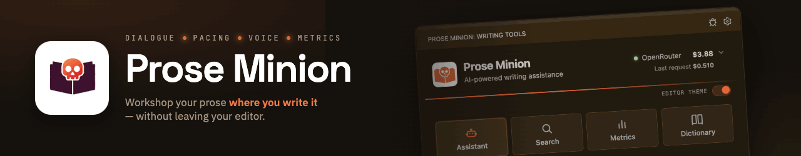

  

<h3 align="center">Workshop your prose where you already write it.</h3>

  Select an excerpt, attach a context brief built from your own story bible, and run focused craft passes — dialogue, gesture, cliché, continuity, metrics — without leaving VS Code. Bring your own OpenRouter key; Metrics, Word Search, and the Lightbox's measurements need no key at all.

  
  
  

  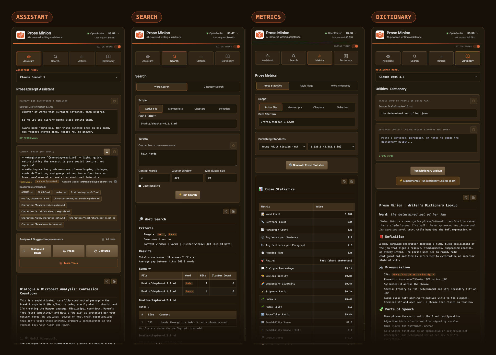

---

## What's new in v2.13.0 — a Workshop that remembers, and edits with you

Everything here lives in the Workshop, the writers' room in an editor tab.

### Suggested edits you apply

**A persona can now suggest an edit to a file in your project**: a note, a chapter, or the document your excerpt came from. Each edit arrives as a card under the reply, with every change shown against your text. **Apply** lands it as one change you can undo, **Review in editor…** opens it in VS Code's Refactor Preview first, and **Decline** sets it aside. Nothing changes in a file until you apply a card, and the file is never saved for you.

**A reply says what it offers.** When a reply names small fixes or writes out a rewrite, its footer shows a chip for each: one for the fixes, and one for each version of a rewrite. Press a chip and the reply's author comes back with exactly those edits as cards, or one line saying there is nothing to change. Unasked, a persona keeps its edits to your chapters small; a larger rewrite comes only from a chip you pressed. Turn suggestions off under **Suggested file edits** in conversation settings.

  

### Project Memory

**Give the Workshop a memory of your project.** Turn it on in conversation settings, on the **Memory** tab. With **Ask first**, a persona can suggest a note under its reply, and it is saved only when you choose **Save**. With **Save and tell me**, personas save what's worth keeping and say so in the thread. You can save any message yourself with **Save to memory…**: the sheet opens at once, and a small helper drafts its title, summary, and kind while you look. Anything you type first is kept.

Each memory is a Markdown file in `prose-minion/memory/`, with a kind: decision, canon, theme, idea, open thread, or preference. Later conversations in the project start knowing every memory's title and summary; a persona opens a full note when it needs it, and the few you mark **Always load in full** arrive whole. Browse, edit, archive, and delete them from **Sessions → Memory…**. A suggested note that speaks of you near a personal word is held as a card for you to decide, in either mode. Project Memory is off until you turn it on.

  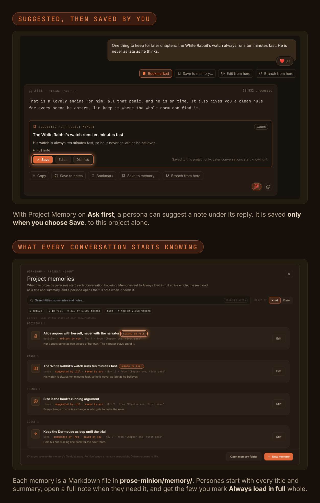

### Pinned context

**Stop attaching the same files to every conversation.** In conversation settings, the **Pinned context** tab keeps a list of the files most conversations need: characters, places, the project brief. Every new conversation in the project starts with them attached, in your order, and marks them with a pin. After that, a conversation's context is its own: removing a file there doesn't unpin it. The list is a file in your project, `prose-minion/pinned-context.json`, of up to 50 files.

  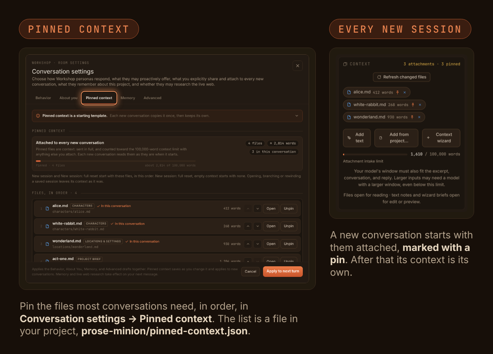

### Bookmarks, reactions, and finding your way around

**Bookmark any message.** The rail now has two tabs: **Material** holds the excerpt, the context, and a **Read in** list of what a persona read or ran, and **Notes** holds your to-dos and bookmarks. **Sessions → Bookmarks…** browses every bookmark in this conversation and in your saved sessions: preview one, open its session at the bookmark, or choose **Remember this** to save it as a project memory. Ask a persona what you bookmarked, and it can look.

**React to a reply.** Pick an emoji under a reply, and its author hears of it with your next message. Now and then a persona reacts to one of your messages too, and its reaction sits on the corner of your message. A reaction never starts a model call on its own, and the `Workshop › Reactions: Personas` setting turns personas' reactions off.

**See which model wrote what.** Each reply's header names the model that wrote it, and a divider marks where the model changed mid-conversation. Exports carry the same headers.

  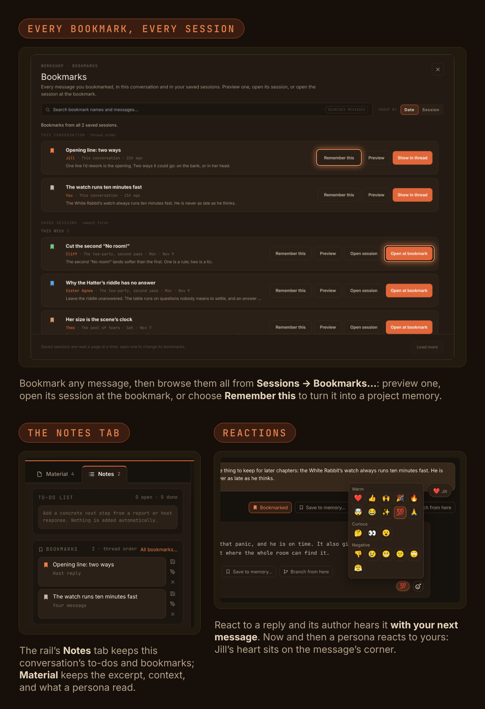

### Also in v2.13.0

- **Personas can do more in one turn** — up to 15 look-ups a turn, with more saved-session and memory reads among them.
- **Four new models to try** — Claude Fable 5.2, Gemini 4 Carbon, Muse Ember, and Tencent Hy4 join the model pickers as opt-in choices. Defaults and saved selections are unchanged; their prose quality has not been evaluated in Prose Minion.
- **A tidier model list** — Mercury 2.5, Mercury 3, Hermes 3 70B, and Hermes 3 405B leave the curated list after OpenRouter stopped listing them. Saved settings are not rewritten.
- **A helper model** — the memory sheet's draft is a small call on its own model setting, which follows Proofread's until you choose one. Turn drafting off in Settings.

**If you sync a project between machines, update Prose Minion on all of them first.** Sessions saved by v2.13.0 can hold bookmarks, model stamps, reactions, memory cards, and edit cards, and an earlier version cannot open a session that holds them.

Asking for edits and drafting a memory call your model and may cost money, and saved memories add to what each conversation sends. Read a card before you apply it. These features are backed by extensive automated tests and the author's own use. Wider live-provider quality checks are still in progress.

### Earlier releases

- **v2.12.0 — Lightbox and Draft Edit.** A chapter on one board, measured by code and then read through AI lenses with checked quotes; and Proofread and Craft Flags from the editor's right-click menu. [See the Lightbox](#the-lightbox-hold-a-chapter-up-to-the-light) and [Draft Edit](#draft-edit-proofread-in-place).
- **v2.11.0 — Dictionary lookup history.** Step back through up to 500 lookups, reopen one without generating again, and get offered a saved result before you look up a phrase twice. [See the Dictionary](#a-dictionary-that-writes-fiction).
- **v2.10.1 — Gemini 4 Argon** joins the model pickers.
- **v2.10.0 — Show vs. Tell and Chromatic Palettes.** A Workshop widget that moves one beat along a five-position continuum, and named color palettes at the end of Dictionary entries.
- **v2.9.0 — Workshop transcripts across sessions.** Export a conversation as Markdown, JSON, or styled HTML, and let personas read your other saved sessions.
- **v2.8.0 — Cache-aware Workshop conversations.** Prompt caching for Claude and supported Qwen routes, a cache clock, and room for 100,000 words of standing context.
- **v2.7.0 — Rewind, branch, and explore.** Rewind, edit, or branch a Workshop conversation; Craft Steering; and the Dictionary's Topic & Related Lexicon.
- **v2.2.0–v2.6.2** — Conversation Widgets, safer Git-synced sessions, Model Explorer, cache reporting, and regular model-catalog updates.

Full history → [CHANGELOG.md](https://github.com/okeylanders/prose-minion-vscode/blob/main/apps/vscode-extension/CHANGELOG.md)

---

## Get started in three steps

1. **Install** from this Marketplace page, then open the Prose Minion panel from the activity bar.
2. **Try Metrics, Word Search, or a Lightbox board** right away — they measure offline, no API key needed.
3. **Add an OpenRouter key** to unlock the Assistant, Context Search, Dictionary, Workshop, Lightbox readings, and Draft Edit.

  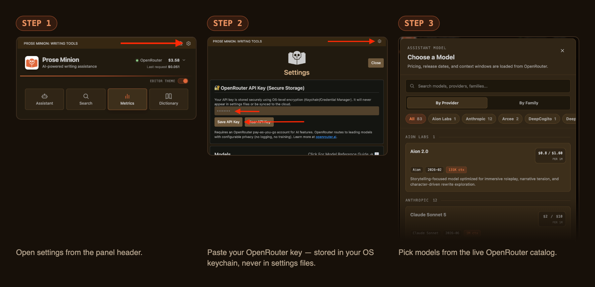

Want a guided, no-code walkthrough — project folders, glob patterns, every setting explained? → **[Read the Setup Guide](https://proseminion.app/setup-guide)**

---

## Four tools, one sidebar

| Tool | What it does | OpenRouter API key? |
|---|---|---|
| 🤖 **Assistant** | Dialogue tags, action beats, and cliché/repetition/show-vs-tell passes on a selected excerpt or whole chapter, optionally grounded in a context brief pulled from your story bible | 🔑 required |
| 🔍 **Search** | Word Search (pattern matching + cluster detection) and Context Search (find words by *meaning* — `[anger]`, `[color red]`, `[movement verbs]`) | Word Search free · Context Search 🔑 |
| 📊 **Metrics** | Word count, pacing, dialogue %, lexical density, readability, hapax rate, publishing-standard comparisons by genre and trim size, per-chapter breakdowns | ✅ free, offline |
| 📖 **Dictionary** | Fiction-focused definitions — pronunciation, sense explorer, register, character-voice variants — for any selected word | 🔑 required |

### Beyond the sidebar

| Tool | What it does | OpenRouter API key? |
|---|---|---|
| 💬 **Workshop** | A writers' room in an editor tab: persona hosts and guests, your excerpt and story-bible context, the writing tools, and interactive widgets, in one saved conversation, with a project memory and suggested edits you apply | 🔑 required |
| 🔦 **Lightbox** | A chapter on one board: measured by code, then read through AI lenses whose quotes are checked against your text | Measuring free · readings 🔑 |
| ✍️ **Draft Edit** | Proofread and Craft Flags from the editor's right-click menu: findings in the Problems panel, and fixes you choose in Refactor Preview | 🔑 required |

Curious what real output looks like on an actual manuscript? → **[Browse the Examples gallery](https://proseminion.app/examples)**

---

## The Assistant

Pin an excerpt, attach a context brief built from your own characters and canon, and run a pass. The analysis respects what you've marked as intentional — and pushes on everything else.

  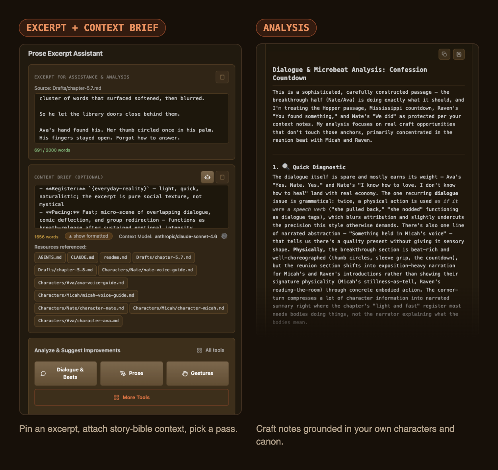

Focused passes, from Dialogue & Beats to Continuity — each one a single, opinionated read of your excerpt:

  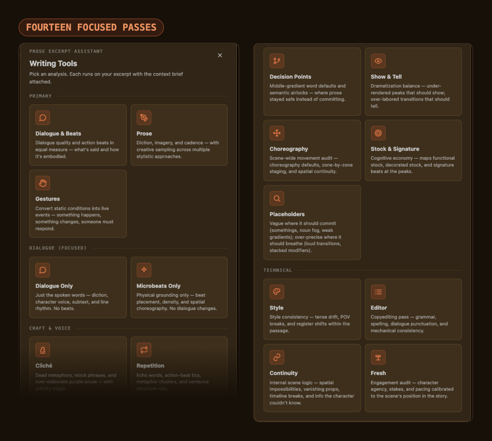

*This overview image predates Craft Steering; its card is shown below.*

**Craft Steering** appears under **Craft & Voice** in both the sidebar's Writing Tools picker and the Workshop tab's Tools picker. Inspired by Ursula K. Le Guin's *Steering the Craft*, it examines sound, rhythm, and how each sentence leads into the next. Its report identifies what to preserve, audits sound and narrative control, and traces sentence handoffs. Sample revisions show small changes; Creative Variations explore distinct treatments of a selected passage; Bound Creative Variations isolate particular craft choices. Each revision explains its gains and costs, followed by a fidelity check and optional read-aloud practice. Intentional pauses, repetition, fragments, and lyrical swells are assessed for their effect. You can also ask a Workshop persona to run Craft Steering on a passage in the conversation.

  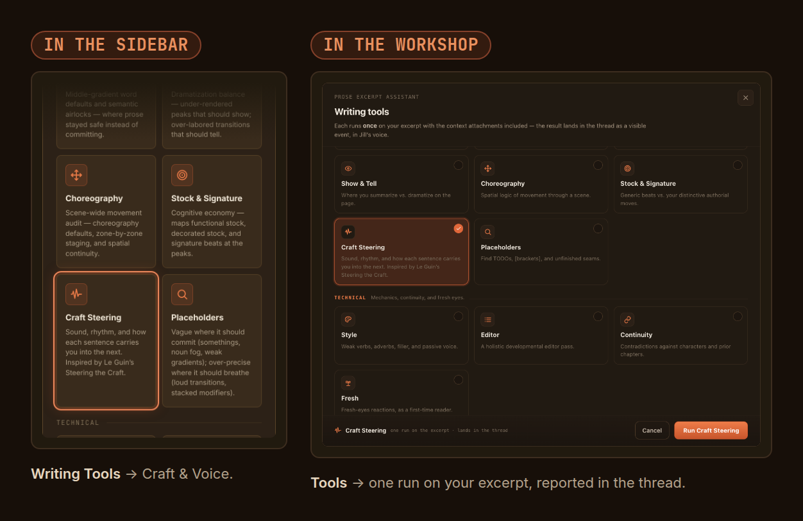

---

## The Workshop: a writers' room in an editor tab

Choose **Open Workshop**, or select a passage and choose **Send Selection to Workshop**. Pick Jill or a specialist host, invite persona guests, and keep the work in one thread that saves itself to your project. Attach standing context of up to 100,000 words, run the writing tools in the room, and turn findings into a to-do list everyone can see. The Workshop is in beta.

**Explore one idea at a time.** Gesture Playground, Lexical Gravity, Creative Variations, and Show vs. Tell are widgets with a commit point you control. Show vs. Tell moves a told beat along a five-position continuum from **State it** to **Inhabit**, with a readout of what each position gains and costs, then returns alternatives to keep as prose or as a direction. Nothing is inserted into your manuscript.

  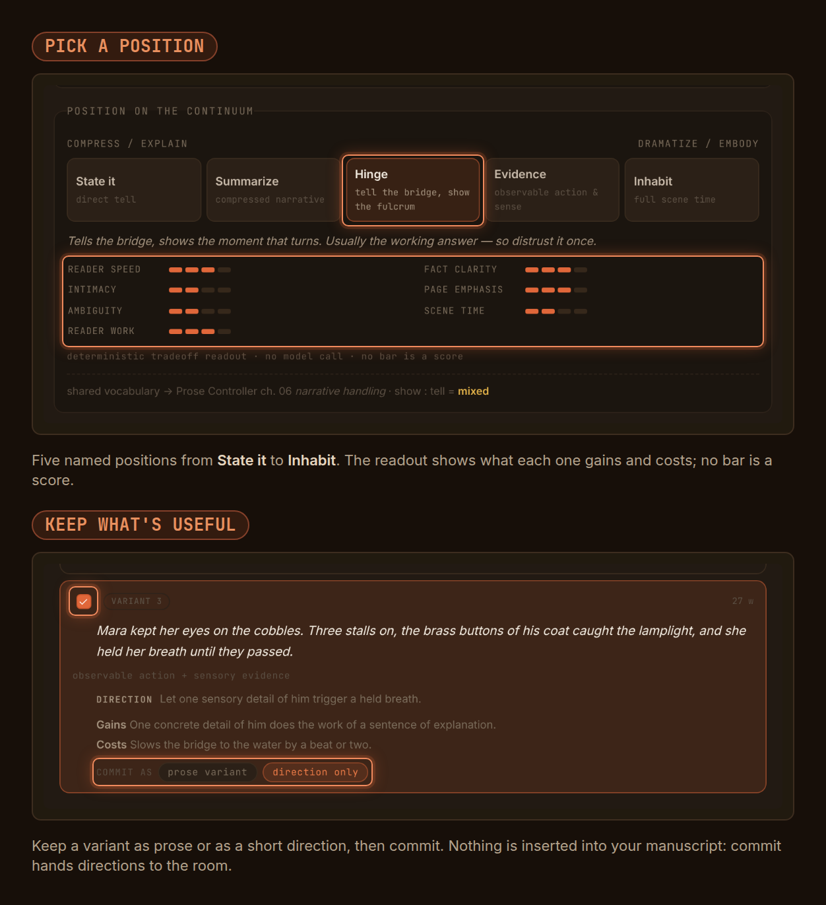

**Try another direction.** Rewind to a reply, edit an earlier message and send it again, or branch into a new saved session and leave this one as it is. Rewind asks before it removes anything.

  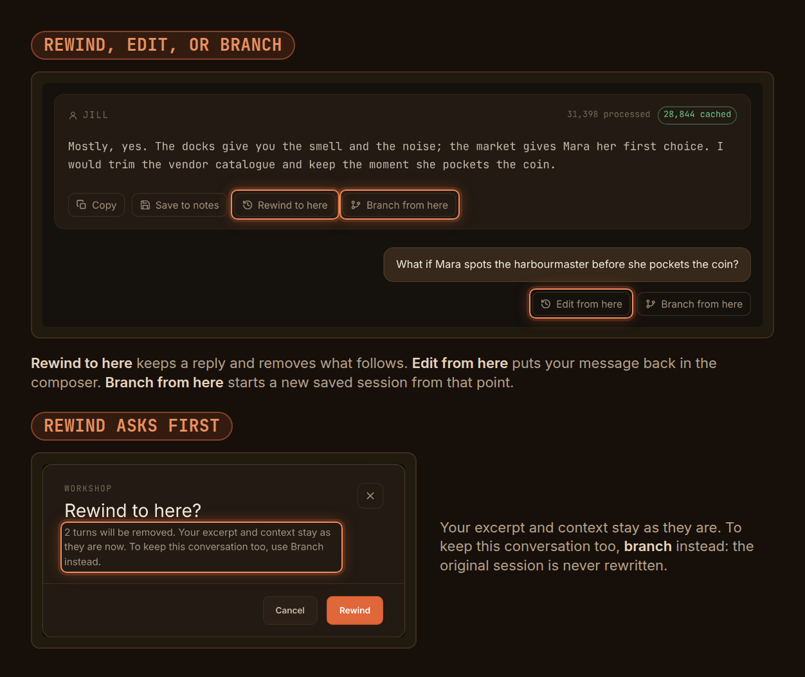

**Take the conversation with you.** **Sessions → Export…** saves a conversation as Markdown, JSON, or styled HTML in `prose-minion/exports/`. Ask about earlier work, and your host or a guest can search and read your other saved sessions: each look-up shows as a **Session Recall** card, and the reply names the session and turns it used.

  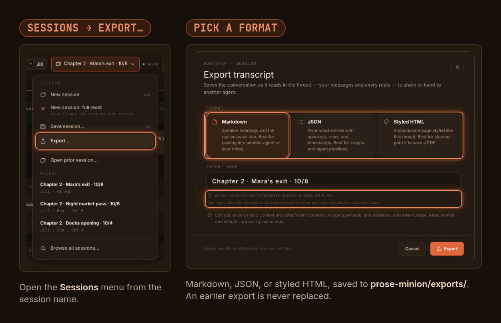

  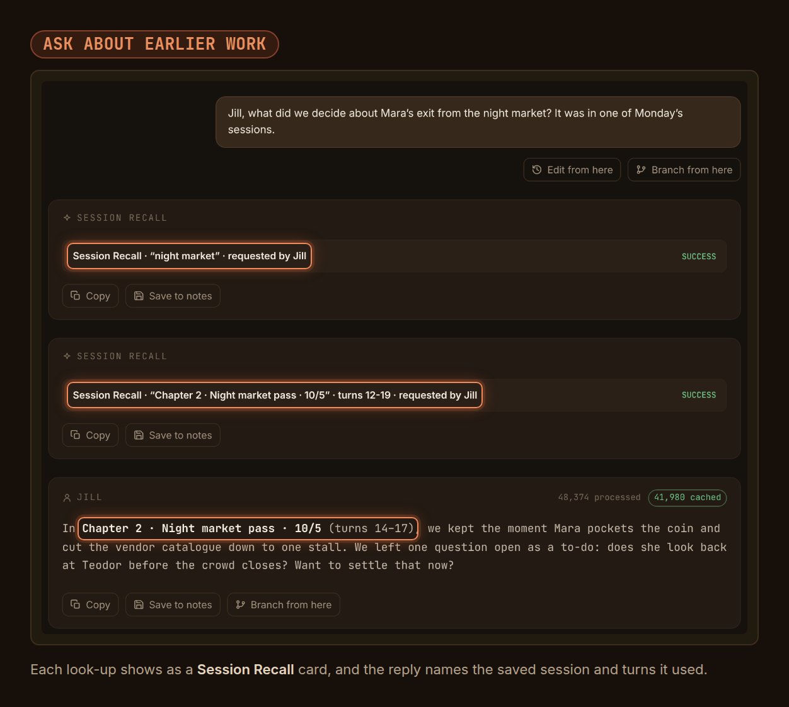

**Cache-aware.** For Claude and supported Qwen routes, the Workshop caches retained conversations. A clock beside the composer estimates the cache window, and each reply's **cached** count shows real reuse. Choose a five-minute or one-hour Claude cache in General settings; cache writes cost more than ordinary input.

**It remembers, and it edits with you.** Personas can suggest edits to your files as cards you apply, keep a Project Memory, start every conversation with your pinned context, and read your bookmarks. [See what's new in v2.13.0](#whats-new-in-v2130--a-workshop-that-remembers-and-edits-with-you).

**Git-synced projects:** update Prose Minion on every machine together. Sessions saved by a newer version may not open in an older one.

---

## The Lightbox: hold a chapter up to the light

**See the chapter before you ask anything.** Choose **Open File in Lightbox** from the editor's title bar, the Explorer, or the editor's **Prose Minion** menu, or select a passage and choose **Open Selection in Lightbox**. The chapter opens on a board in its own tab, measured by code: a paragraph ribbon of rhythm and dialogue, the numbers, top words, parts of speech, repeated phrases, style flags, and the words used only once. Hover anything to light the paragraphs it touches, and pin it to see every sentence behind the count. Measuring asks no model and needs no key.

  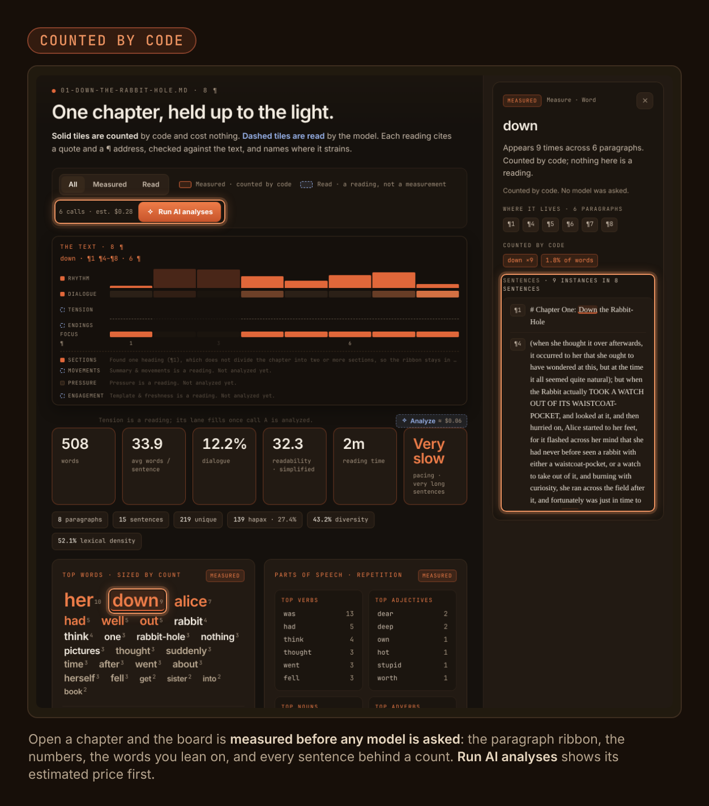

**Ask for readings when you want them.** Twenty lenses, in up to seven calls, read the chapter for its headline, motifs, tension, lexical gravity, palette, characters, voice, subtext, genre neighborhood, lineage, sparks, stock and signature phrasing, rhythm and handoffs, the numbers, template and freshness, pressure, artifacts, movements, and craft steering. Last, an **Opinion** weighs the board's own readings. Each call shows an estimated price before you press it. Run them all, finish the calls that haven't run, run a single call, or re-analyze one tile. Every reading cites a quote and a ¶ address that code checks against your chapter, and a claim whose quote isn't found is withheld. Earlier readings stay on the board until a usable replacement lands.

  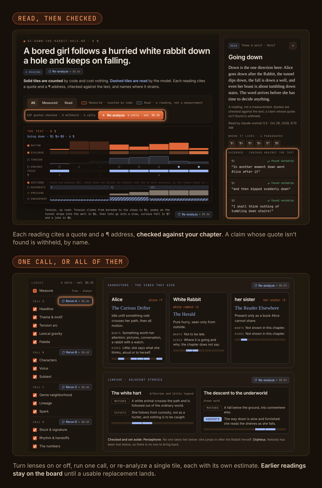

**Keep your boards, and bring readings to the Workshop.** In a single-folder workspace, each board saves itself as one file in `prose-minion/boards/`. Name boards, browse every chapter's, and reopen one exactly as it was read; if the chapter has changed since, **Read the current text** starts a new board. With no folder, or several, boards last for the session. **Bring to Workshop** stages a reading's claim and its checked quotes above the Workshop composer, and **Build as a lens** opens a lexical field in Lexical Gravity. Nothing is sent until you send it.

  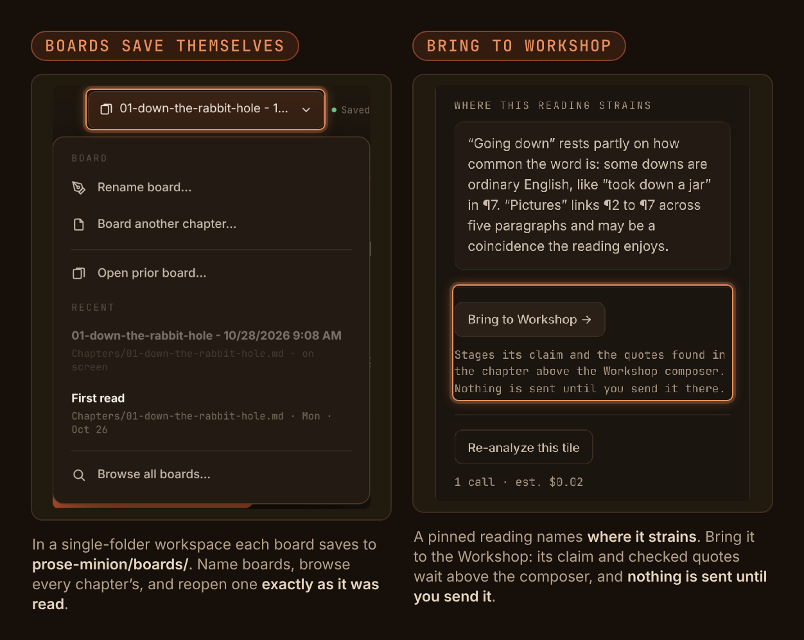

---

## Draft Edit: proofread in place

**Proofread where you write.** Right-click a Markdown or plain-text file and choose **Prose Minion → Proofread and Flag** or **Proofread and Fix**, for the whole file or a selection. Proofread looks for spelling, homophones, punctuation, capitalization, spacing, agreement, and missing or extra words. It also checks the whole document for names spelled two ways, inconsistent spellings, stray quotation marks, and slips in tense or person against your narration. Each finding appears in the editor and the Problems panel, with a quick fix where one is safe. By default, **Proofread and Fix** opens its fixes in VS Code's Refactor Preview, where you tick the ones to apply. They land as one change you can undo, and the file is never saved for you. Tense, agreement, and other judgment calls are only ever flagged. Name a spelling convention and keep a word list of your own names and invented words in Settings.

  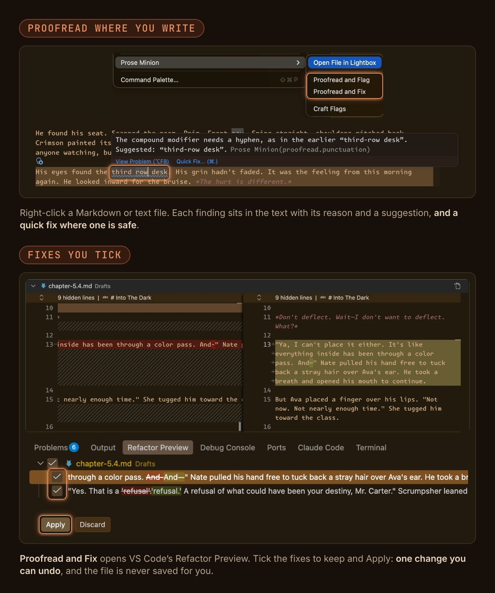

**Craft Flags** leaves line notes for clichés, shifts in register, leaned-on gestures, and continuity slips. They are notes, never edits, and a continuity note points to both places. Choose which categories run. Before anything is sent, a confirmation shows the planned requests and their estimated cost.

  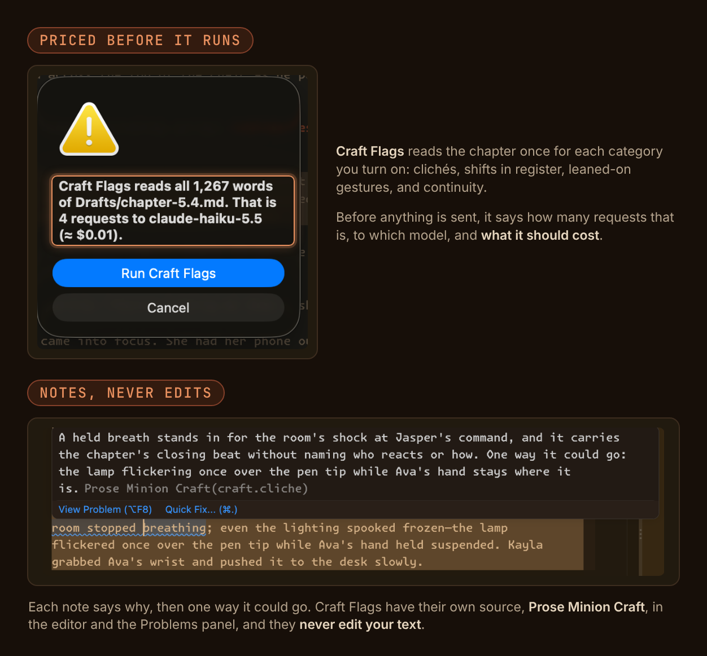

Proofread has its own model, an inexpensive one by default. Craft Flags and the Lightbox follow your Workshop model until you choose one for them, and choosing never changes the Workshop's. Each Draft Edit pass has its own reasoning setting.

Lightbox readings, Proofread, and Craft Flags call your model and may cost money; review estimates and proposed edits before you accept them.

---

## Search: by pattern, or by meaning

Word Search finds every occurrence and flags clusters — free and offline. Context Search finds words by *meaning*: ask for "emotion verbs" and get `flinched`, `froze`, `hated` back with counts.

  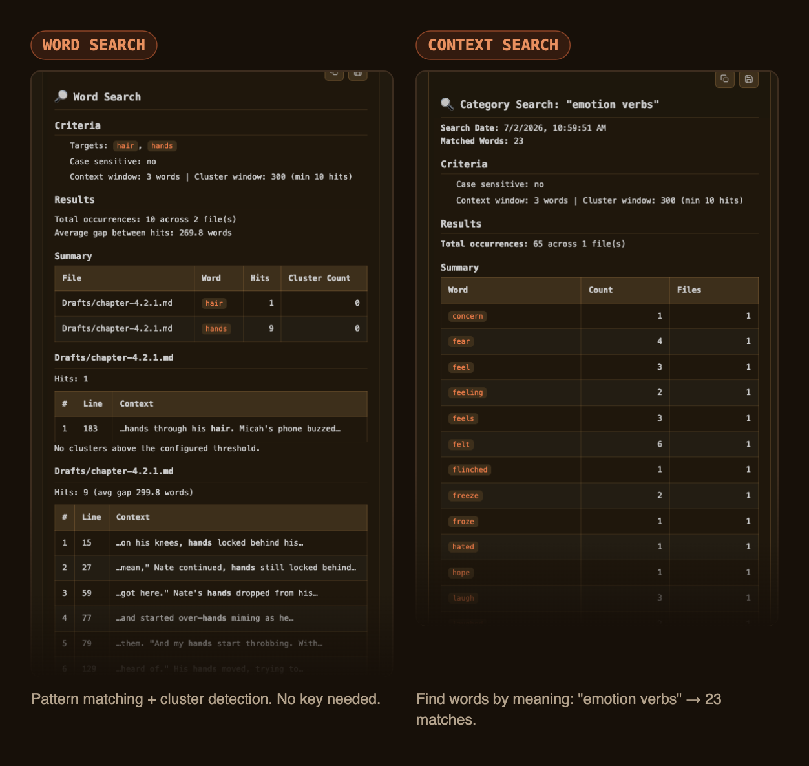

---

## Metrics: know your manuscript

All offline, no key, no cost — from a single chapter to the whole draft, with publishing-standard comparisons by genre and trim size.

  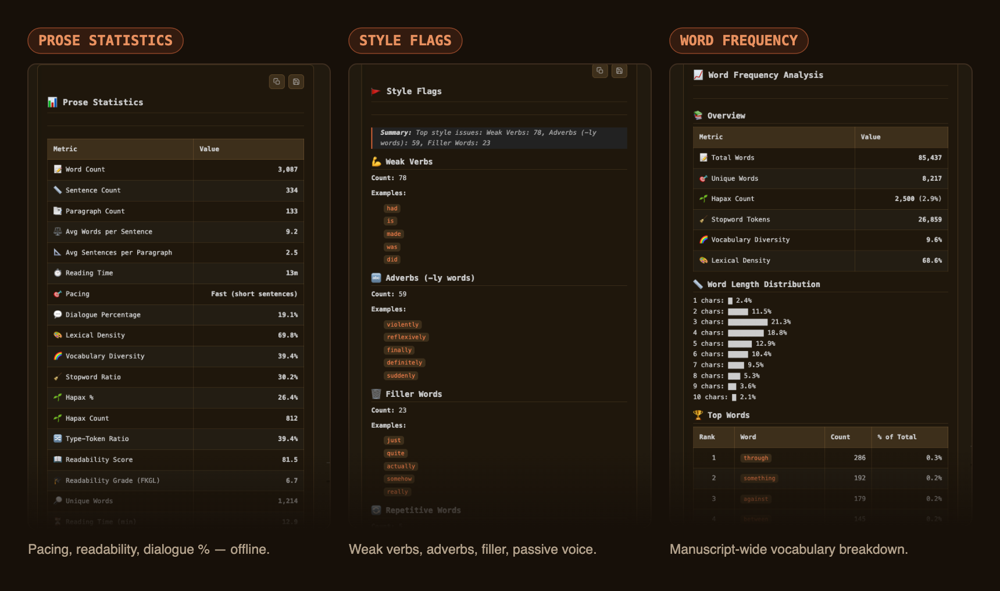

---

## A dictionary that writes fiction

Not a definition lookup — a craft reference: connotation, register, sense explorer, soundplay, and character-voice variations for any word or phrase in your draft. Leave **Topic & Related Lexicon** on to close each entry with topic explanations, related vocabulary, writing examples, and possible reference books.

  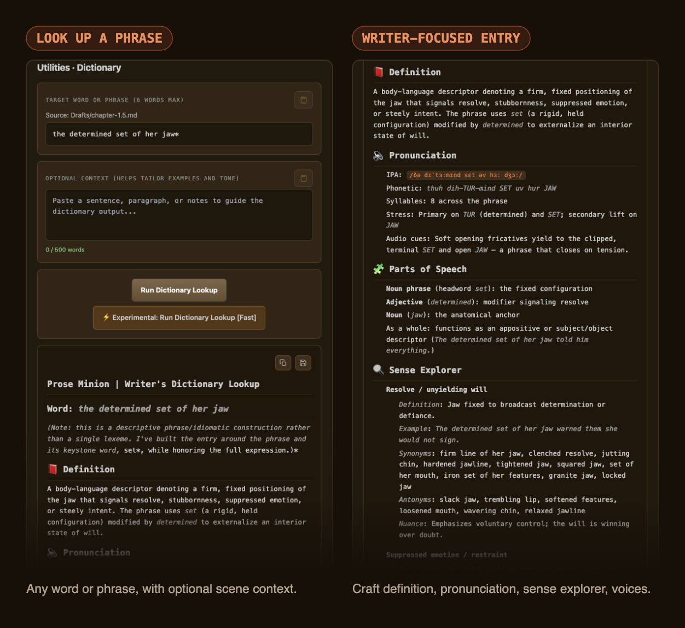

  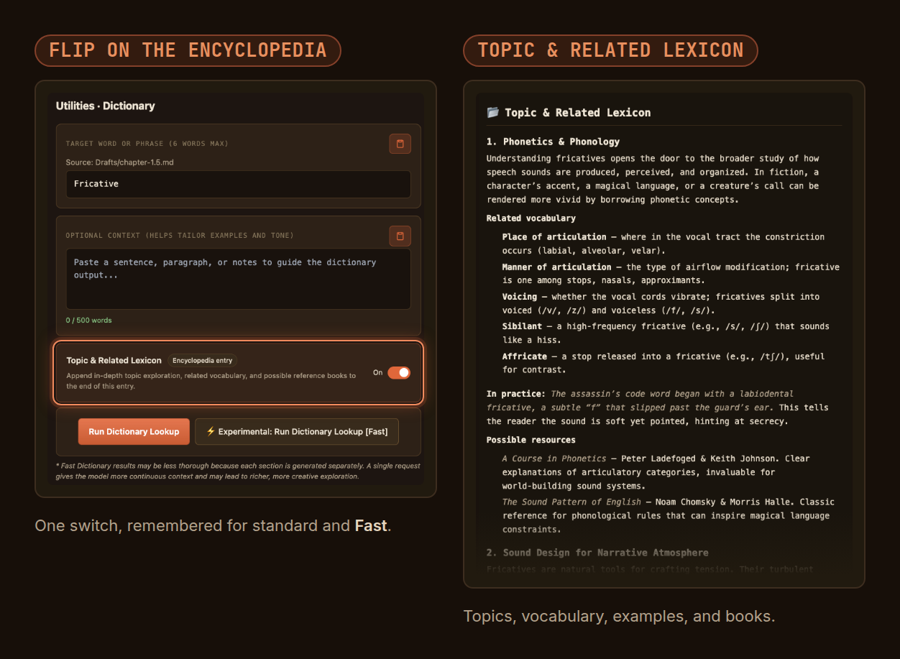

  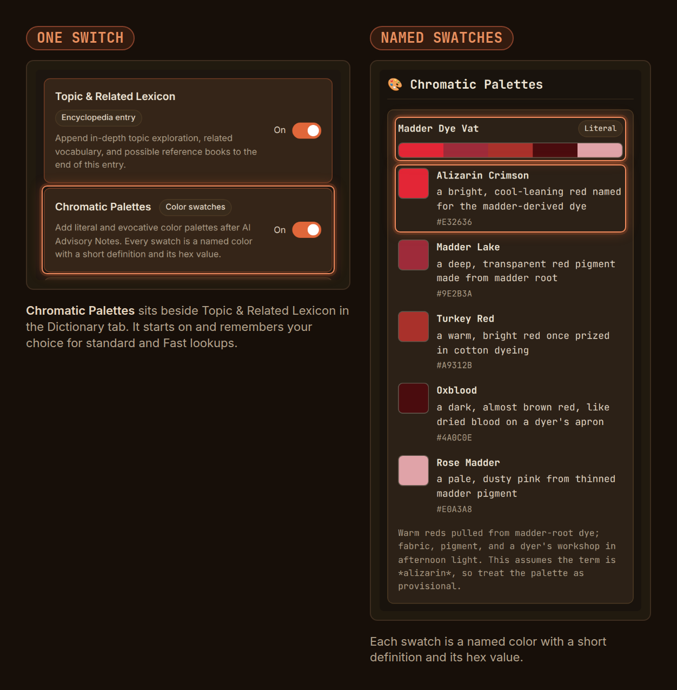

  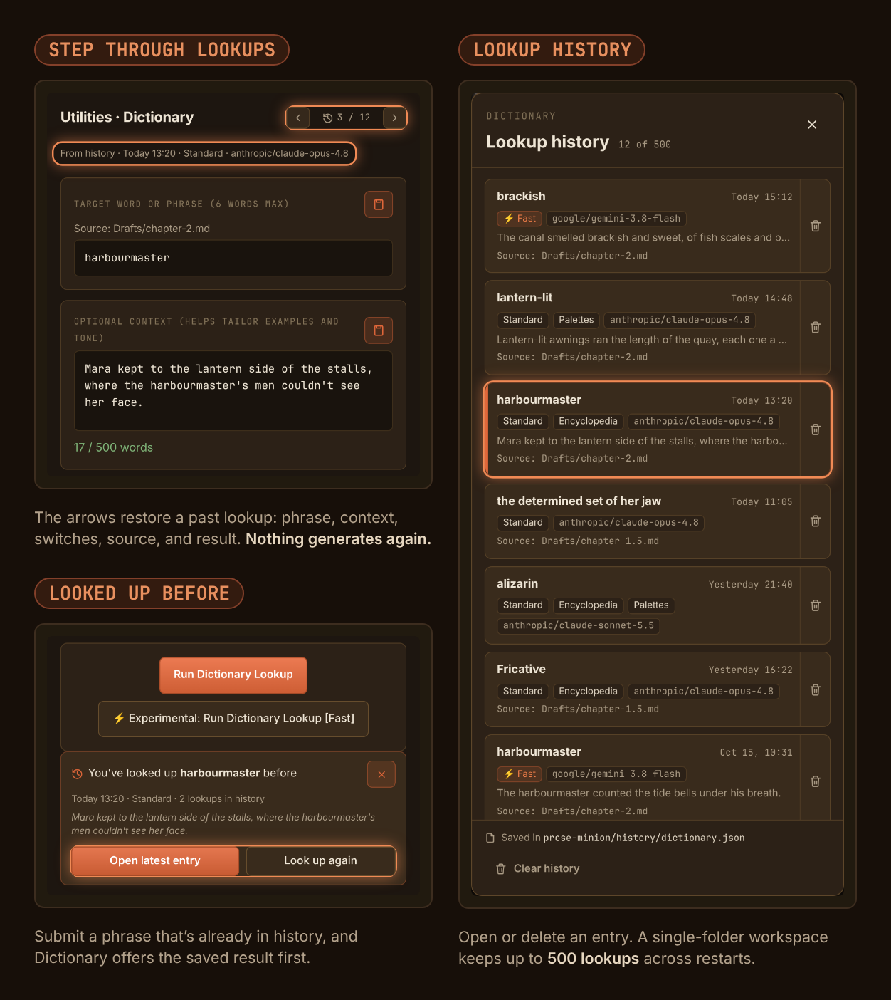

---

## Project structure & context

The Assistant's context features shine with a lightly organized project: one chapter per file, plus folders for characters, locations, and story-bible material that Prose Minion turns into clickable resource pills during analysis. The **[Setup Guide](https://proseminion.app/setup-guide)** walks through the whole layout — including glob patterns, demystified — in about five minutes, no coding required.

---

## Privacy

- API key stored in your OS keychain via VS Code `SecretStorage` — never written to settings files.
- Metrics, Word Search, and the Lightbox's measurements run entirely offline; nothing leaves your machine.
- The AI tools — the Assistant, Context Search, Dictionary, Workshop, Lightbox readings, Proofread, and Craft Flags — call OpenRouter only when you run them, and only with the text you send them. With Project Memory on, that includes the saved notes a Workshop conversation starts with; the memory sheet's draft sends the one message you are saving.
- Workshop sessions, project memories, the pinned-context list, Lightbox boards, and Dictionary history are files in your project's `prose-minion/` folder.
- A Workshop persona can suggest an edit to a file, but only you apply it, and Prose Minion never saves the file for you.
- There's no Prose Minion server — your writing has nowhere else to go.

---

## Requirements

- VS Code 1.82.0 or higher. Prose Minion's panels are styled with CSS that needs the browser engine VS Code 1.82 ships (Chromium 114), and on older versions they can lose their colors.
- An [OpenRouter](https://openrouter.ai/) account for AI-powered tools (pay-as-you-go; Metrics, Word Search, and the Lightbox's measurements need nothing)

---

## License

**AGPL-3.0 with Commons Clause** — source-available, no resale, no closed-source derivatives. Free for personal and open-source use; see [LICENSE](https://github.com/okeylanders/prose-minion-vscode/blob/main/apps/vscode-extension/LICENSE) for full terms. Commercial licensing: open an issue.

---

## A note from the author

I built Prose Minion for my own novel-writing workflow, pairing it with [Cline](https://cline.bot) as a copy-paste-friendly analytical companion: metrics and word searches from Prose Minion, revision discussion in Cline's chat. I kept going because it turned out other writers wanted the same setup — so here it is, publicly available. Happy writing.

## Acknowledgments

Built with [OpenRouter](https://openrouter.ai/), the [VS Code Extension API](https://code.visualstudio.com/api), and React. Development assisted by [Cline](https://github.com/cline/cline), [Claude Code](https://www.anthropic.com/claude), and OpenAI Codex.

---

## Support development

If Prose Minion earns a place in your workflow, consider [buying me a coffee](https://buymeacoffee.com/okeylanders) — it funds the OpenRouter catalog audits and keeps this maintained.

---

  <a href="https://proseminion.app">Website</a> •
  <a href="https://proseminion.app/setup-guide">Setup Guide</a> •
  <a href="https://proseminion.app/examples">Examples</a> •
  <a href="https://github.com/okeylanders/prose-minion-vscode/blob/main/apps/vscode-extension/CHANGELOG.md">Changelog</a> •
  <a href="https://github.com/okeylanders/prose-minion-vscode/issues">Report an Issue</a>

