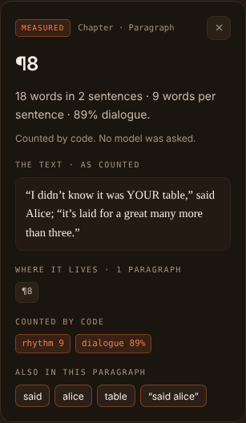
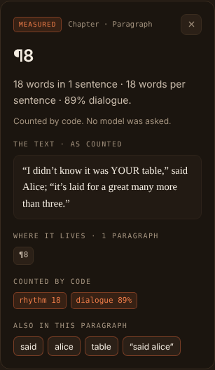

# Sentence rule evidence: a sentence keeps its closing marks

The shared sentence splitter (`proseSentenceSpans`) now keeps the closing
quotation marks and brackets written directly after a sentence's `.`, `!` or
`?`. Before, the closing mark started the next sentence, and at the end of a
paragraph it stood alone as a sentence. The rule and its edge cases are in
[ADR 2026-10-21: Sentence closing marks](../../../adr/2026-10-21-sentence-closing-marks.md).

This note records what moved, on public-domain text only:
- the measured figures, before and after, on the *Alice* fixtures;
- one Chromium capture of the Slice 4E paragraph inspector, before and after.

## What is here

| Path | Contents |
|---|---|
| `inspector-before.png`, `inspector-after.png` | The inspector with ¶8 of the Tea-Party pinned, at 1440 px, on the old rule and on the new |
| `facts-before.json`, `facts-after.json` | The board's ¶8 metrics and what the inspector showed, read from the DOM by `harness.js` |
| `errors-before.txt`, `errors-after.txt` | Every page error and failed expectation. Both are empty |
| `states/before.json`, `states/after.json` | The host's messages for the Tea-Party board, its estimate, and ¶8's passage, built on each rule |
| `harness.js` | Cut down from [`../lightbox-slice-4e-visual/harness.js`](../lightbox-slice-4e-visual/harness.js) to its `paragraph` state. It fails if the inspector's claim does not state the board's own words and sentences for ¶8 |
| `tools/build-states.test.ts` | How `states/` was made |

## Measured figures

### Whole-text prose stats

These are the Metrics tab's figures and the board's headline. Readability is
the tool's simplified Flesch score (100 − 2 × words per sentence); the grade
is its Flesch–Kincaid estimate.

| Fixture | Words | Sentences | Words per sentence | Readability | Grade | Pacing |
|---|---|---|---|---|---|---|
| Worked examples' ¶1–¶8 (groups A–E share them) | 508 | 17 → **16** | 29.9 → **31.8** | 40.2 → **36.5** | 12.0 → **12.8** | Slow → **Very slow** |
| The opening, curly, straight, mixed or wrapped quotes (identical) | 226 | 10 → **9** | 22.6 → **25.1** | 54.8 → **49.8** | 9.6 → **10.5** | Slow (unchanged) |
| `aliceWords(6000)`, the opening's vocabulary repeated | 6,000 | 244 (unchanged) | 24.6 | 50.8 | 10.2 | Slow |
| Tea-Party, single quotes as Gutenberg sets them | 435 | 33 → **32** | 13.2 → **13.6** | 73.6 → **72.8** | 4.4 → **4.5** | Moderate (unchanged) |
| Tea-Party, curly double quotes (50.8% dialogue) | 435 | 33 → **32** | 13.2 → **13.6** | 73.6 → **72.8** | 4.4 → **4.5** | Moderate (unchanged) |
| Chapter I, as the Lightbox evidence cuts it | 2,186 | 85 (unchanged) | 25.7 | 48.6 | 9.7 | Slow |
| The whole book, as the Lightbox evidence cuts it | 26,448 | 1,629 → **1,628** | 16.2 (unchanged) | 67.5 | 6.3 | Moderate |

**In ordinary prose the whole-text count moves by at most one.** Across a
whole text, a closing mark that began a sentence also began that sentence's
words, so it was not counted alone, except after the last sentence of the
text. (Only a closing mark followed by nothing but another end mark, such as
`!” .`, also counted alone.) Each text above loses exactly that final
fragment, or nothing if it ends without one.

### The Lightbox's per-paragraph figures

These are the rhythm lane, the inspector's paragraph line, the Rhythm &
handoffs lens's sentence lengths, and the passage index. Here every
paragraph that ended with a closing mark counted one sentence too many.

| Fixture | Paragraphs | Paragraph sentences, summed | Paragraphs that moved | Longest sentence | Very short (under 6 words) |
|---|---|---|---|---|---|
| Worked examples' ¶1–¶8 | 8 | 19 → **17** | 2 (¶2: 2 → 1; ¶8: 6 → 5) | 107 → **106** words, ¶4 | 3 → **4** |
| The opening (any quotes) | 6 | 12 → **10** | 2 (¶2: 2 → 1; ¶6: 6 → 5) | 57, ¶2 | 2 → **3** |
| `aliceWords(6000)` | 50 | 292 → **290** | 2 | 58 → **57** | 42 → **69** |
| Tea-Party, single quotes | 19 | 40 → **32** | 8 | 54, ¶1 | 6 |
| Tea-Party, curly double quotes | 19 | 40 → **32** | 8 | 54, ¶1 | 6 |
| Chapter I | 31 | 98 → **91** | 7 (¶2: 2 → 1) | 108, ¶17 | 14 → **15** |
| The whole book | 815 | 2,028 → **1,702** | 326 | 179, ¶146 | 407 → **428** |

- **Longest and very short sentences move too.** The old rule counted a
  stray `”` as a word of the next sentence. So "” she said, and turned
  away." was 6 words, and is now 5: under 6, it is very short.
- **The sentences wells' headers do not move** on any fixture. These are
  the "N instances in M sentences" lines:
  - Chapter I, "alice": 27 in 26;
  - the book, "alice": 385 in 378;
  - Weak Verbs: 119 in 48.
- **The rows' text moves.** On Chapter I, the third "alice" row was
  "” (when she thought it over afterwards…". It is now "(when she thought it
  over afterwards…".
- **Count agreement holds.** `LightboxCountAgreement.test.ts` now also
  checks both Tea-Party settings. For every listed entry, the instances
  shown plus those past the bound equal the board's count.

## The inspector, before and after

Pinned: ¶8 of the Tea-Party in curly double quotes, one line of speech in
two quotations:

> “I didn’t know it was YOUR table,” said Alice; “it’s laid for a great many more than three.”

| | Before | After |
|---|---|---|
| Claim | 18 words in **2 sentences** · **9** words per sentence · 89% dialogue. | 18 words in **1 sentence** · **18** words per sentence · 89% dialogue. |
| Counted by code | rhythm **9** · dialogue 89% | rhythm **18** · dialogue 89% |
| The board's sentence words for ¶8 | [18, 1]: the final `”` alone, counted as a word | [18] |
| The text well | Unchanged | Unchanged |




Both captures:
- show no horizontal overflow and no page error;
- found every recorded answer;
- leave `errors-*.txt` empty.

### How they were made

- **States.** `tools/build-states.test.ts` drives the production
  `LightboxService`, `LightboxHandler`, `LightboxReadingHandler` (for its
  estimate only) and `LightboxPassageHandler`, over the real measurement
  services. No model or provider was called.
  - It ran twice: once with `passageProseStats/index.ts` as it stands at the
    base, `058feb5`, giving `states/before.json`, and once on this branch,
    giving `states/after.json`.
  - The two states differ only in what the rule measures.
- **Bundles.** Before used the base's `webview.js`; after used this
  branch's.
  - Each was built by `npm run build` (with `verify:bundle`) after `npm ci`
    into the worktree's own `node_modules`.
  - Both are SHA-256
    `8d0545decad8bf1e8dac296798ff57343abbb502b6228b5f1148db4c03262a61`, the
    hash Slice 4E recorded. The webview only shows figures the host
    measured, so the change is all in `extension.js`: base `b8cb056a…`,
    this branch `8baf2770…`. This branch's two bundles were reproduced by
    a second build, and the base's `webview.js` by two.
- **Browser.** Headless Chromium from `/opt/pw-browsers`, at 1440 × 1600.
  Theme variables are stubbed and fonts come from the system, as in the 4E
  evidence.

## Source text

All of it is from Lewis Carroll's "Alice's Adventures in Wonderland" (1865),
which is public domain.

- **The Tea-Party** is the opening of Chapter VII, "A Mad Tea-Party": lines
  1573–1631 of the Project Gutenberg text (EBook #11, SHA-256
  `f00b287e…0752`, from the `wordcloud` 1.9.3 sdist, as the earlier Lightbox
  evidence took it).
  - Wrapped lines are joined into paragraphs, and nothing else is changed.
  - The curly setting changes only the quotation marks, by a rule a test
    pins.
  - It is committed as test fixture prose: `teaPartyFixtures.ts`.
- **The opening, the worked examples and `aliceWords`** are the Lightbox
  tests' existing fixtures.
- **Chapter I and the whole book** were cut by
  `../lightbox-slice-2a-visual/tools/alice_chapter.py`. Chapter I came out
  with SHA-256 `52801900…1088`, byte-identical to the Slice 2A and 4E
  fixture. These cuts are not committed.

## What else moved

**Worked examples.** Only group F's moved.
- Its request (the Opinion's digest) states the board's sentence figures.
  It was regenerated from `buildLightboxOpinionUserMessage`, the builder
  `LightboxOpinionBundle.test.ts` holds it byte-identical to:
  - "17 sentences" → "16";
  - "29.9 words per sentence" → "31.8";
  - "pacing: Slow (longer sentences)" → "Very slow (very long sentences)";
  - "(×2.09)" → "(×2.22)" against the synthetic average of 14.3;
  - "(measured: 29.9 avg)" → "31.8".
- Its response states the figure its observation cites, so the gate would
  withhold "29.9". The response's two "29.9"s, and the one in the note
  after it, now read "31.8". Nothing else in it changed.
- Groups A–E's requests carry no sentence figure that moved, and still
  match their builder byte for byte.

**Committed evidence states that would change if rebuilt.** None was
rebuilt, and no old slice's evidence was rewritten.
- `lightbox-slice-2a-visual/boards/{board,book}.json`,
  `lightbox-slice-2b-visual/states/{chapter,book,withheld}.json`,
  `lightbox-slice-3-visual/states/chapter.json` and
  `lightbox-slice-4-visual/states/chapter.json` hold Chapter I's or the
  book's board.
  - Chapter I's per-paragraph sentences: 98 → 91.
  - The book's per-paragraph sentences: 2,028 → 1,702.
  - The book's headline: 1,629 → 1,628 sentences.
- `lightbox-slice-4b-visual`, `4c` and `4d`'s `states/chapter.json` hold the
  worked examples' board: 17 → 16 sentences, 29.9 → 31.8 words per
  sentence, and the figures above.
- `lightbox-slice-4e-visual/states/chapter.json` holds both boards and the
  passages. Its README's "¶2 reads 2 sentences" would read 1. The `word`
  state's third row would begin "(when she thought" instead of "”". Its
  well headers would not change.

## Rerunning it

1. Copy `tools/build-states.test.ts` into `packages/core/src/__tests__/`.
2. Run it with
   `SENTENCE_RULE_EVIDENCE_OUT=$DIR/states/after.json npx jest packages/core/src/__tests__/build-states.test.ts`.
   For `before.json`, first put the base's
   `packages/core/src/tools/measure/passageProseStats/index.ts` in place,
   then restore this branch's after.
3. Delete the copy. Do not run the full suite while it is there.
4. Build the bundle (`npm run build`) and render each state from this
   folder:

   ```sh
   PLAYWRIGHT_BROWSERS_PATH=/opt/pw-browsers node harness.js $DIR/webview.js states/after.json $DIR/visual after
   ```

The process exits 1 if `errors-<tag>.txt` is not empty. Keep `$DIR` outside
the repository.
