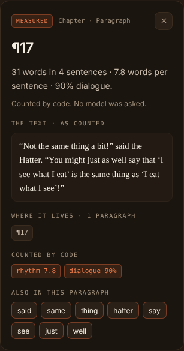
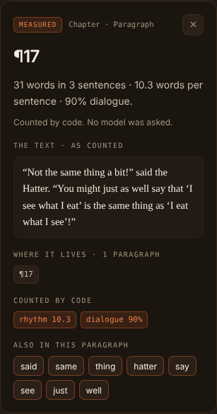

# Sentence rule evidence: closing marks and speech tags

The shared sentence splitter (`proseSentenceSpans`) changed twice on this
branch:
1. **Closing marks.** A sentence keeps the closing quotation marks and
   brackets written directly after its `.`, `!` or `?`. Before, the mark
   started the next sentence, and at the end of a paragraph it stood alone
   as one.
2. **Speech tags.** A lower-case speech tag continues the sentence of its
   speech: `“Wait!” she cried.` is one sentence.

The rule and its limits are in
[ADR 2026-10-21: Sentence closing marks and speech tags](../../../adr/2026-10-21-sentence-closing-marks.md).

This note records what each change moved, on public-domain text only. The
figures are at three points, every time in this order:
- **Original:** the rule at Slice 4E's head, `058feb5`.
- **Closing marks:** the first change alone, `fabd95d`.
- **Speech tags:** both changes, this branch's head.

## What is here

| Path | Contents |
|---|---|
| `inspector-base.png`, `inspector-closing-marks.png`, `inspector-speech-tags.png` | The inspector with the Tea-Party's ¶17 pinned, at 1440 px, under each rule |
| `facts-*.json` | The board's ¶17 metrics and what the inspector showed, read from the DOM by `harness.js` |
| `errors-*.txt` | Every page error and failed expectation. All three are empty |
| `states/base.json`, `states/closing-marks.json`, `states/speech-tags.json` | The host's messages for the Tea-Party board, its estimate, and ¶17's passage, built under each rule |
| `harness.js` | Cut down from [`../lightbox-slice-4e-visual/harness.js`](../lightbox-slice-4e-visual/harness.js) to its `paragraph` state. It fails if the inspector's claim does not state the board's own words and sentences for the pinned paragraph |
| `tools/build-states.test.ts` | How `states/` was made |

## Measured figures

### Sentences, and what each change moved

These are whole-text counts: the Metrics tab, the board's headline, the
standards comparison and the writer's average.

| Fixture | Words | Original | Closing marks | Speech tags |
|---|---|---|---|---|
| Worked examples' ¶1–¶8 (groups A–E share them) | 508 | 17 | 16 (−1) | 15 (−1) |
| The opening, curly, straight, mixed or wrapped quotes (identical) | 226 | 10 | 9 (−1) | 8 (−1) |
| `aliceWords(6000)`, the opening's vocabulary repeated | 6,000 | 244 | 244 (0) | 217 (−27) |
| Tea-Party, single quotes as Gutenberg sets them | 435 | 33 | 32 (−1) | 27 (−5) |
| Tea-Party, curly double quotes (50.8% dialogue) | 435 | 33 | 32 (−1) | 27 (−5) |
| Chapter I, as the Lightbox evidence cuts it | 2,186 | 85 | 85 (0) | 78 (−7) |
| The whole book, as the Lightbox evidence cuts it | 26,448 | 1,629 | 1,628 (−1) | 1,388 (−240) |

- **Closing marks** move a whole-text count by at most one in ordinary
  prose. A closing mark that began a sentence also began that sentence's
  words, so it counted alone only after the last sentence of a text.
- **Speech tags** move it by the number of joins: 240 in the whole book.

### The other whole-text figures

Readability is the tool's simplified Flesch score (100 − 2 × words per
sentence). The grade is its Flesch–Kincaid estimate.

| Fixture | Words per sentence | Readability | Grade | Pacing |
|---|---|---|---|---|
| Worked examples' ¶1–¶8 | 29.9 → 31.8 → 33.9 | 40.2 → 36.5 → 32.3 | 12.0 → 12.8 → 13.6 | Slow → Very slow → Very slow |
| The opening (any quotes) | 22.6 → 25.1 → 28.3 | 54.8 → 49.8 → 43.5 | 9.6 → 10.5 → 11.8 | Slow throughout |
| `aliceWords(6000)` | 24.6 → 24.6 → 27.6 | 50.8 → 50.8 → 44.7 | 10.2 → 10.2 → 11.4 | Slow throughout |
| Tea-Party (either setting) | 13.2 → 13.6 → 16.1 | 73.6 → 72.8 → 67.8 | 4.4 → 4.5 → 5.5 | Moderate throughout |
| Chapter I | 25.7 → 25.7 → 28.0 | 48.6 → 48.6 → 43.9 | 9.7 → 9.7 → 10.6 | Slow throughout |
| The whole book | 16.2 → 16.2 → 19.1 | 67.5 → 67.5 → 61.9 | 6.3 → 6.3 → 7.4 | Moderate throughout |

### The Lightbox's per-paragraph figures

These are the rhythm lane, the inspector's paragraph line, the Rhythm &
handoffs lens's sentence lengths, and the passage index.

| Fixture | Paragraphs | Paragraph sentences, summed | Longest sentence | Very short (under 6 words) |
|---|---|---|---|---|
| Worked examples' ¶1–¶8 | 8 | 19 → 17 (−2) → 16 (−1) | 107 → 106 → 106 words, ¶4 | 3 → 4 → 3 |
| The opening (any quotes) | 6 | 12 → 10 (−2) → 9 (−1) | 57, ¶2 | 2 → 3 → 2 |
| `aliceWords(6000)` | 50 | 292 → 290 (−2) → 263 (−27) | 58 → 57 → 57 | 42 → 69 → 41 |
| Tea-Party (either setting) | 19 | 40 → 32 (−8) → 27 (−5) | 54, ¶1 | 6 → 6 → 1 |
| Chapter I | 31 | 98 → 91 (−7) → 84 (−7) | 108, ¶17 | 14 → 15 → 10 |
| The whole book | 815 | 2,028 → 1,702 (−326) → 1,462 (−240) | 179, ¶146 | 407 → 428 → 192 |

- **Closing marks** remove a sentence from every paragraph that ended with
  a closing mark.
  - They also take a stray `”` out of the next sentence's words. "” She
    turned away and ran." was 6 words and is 5, so very short sentences
    rise.
- **Speech tags** remove one sentence per join. They also fold the short
  tags into their speech, so very short sentences fall: the book's go
  428 → 192.

### The sentences wells

These are the "N instances in M sentences" headers.

- **Closing marks moved no header.** A closing-only stretch held no
  instance.
- **Speech tags move "M sentences"** where an item stood in both a speech
  and its tag:
  - Chapter I, Weak Verbs: 119 instances in 48 → 47 sentences;
  - the book, "alice": 385 in 378 → 377;
  - the book, Weak Verbs: 1,181 in 711 → 693.
- **Every other header is unchanged:** Chapter I's "alice" (27 in 26), the
  book's "said" (458 in 451), and every well on the repository's fixtures.
- **The rows' text moves.**
  - On Chapter I, the third "alice" row began "” (when she thought it
    over…" and now begins "(when she thought it over…".
  - On the worked examples, the ¶8 row is now "“Well!” thought Alice to
    herself, …".
- **Count agreement holds.** `LightboxCountAgreement.test.ts` checks
  every listed entry, now including both Tea-Party settings, and passes
  on the merged Slice 4E fixes.

### The joins, audited

On the whole book, the speech-tag rule makes 240 joins:
- 110 before "said";
- then "the" (20), "cried" (15), "she" (14), "and" (13), "thought" (9),
  and so on.

The 21 joins not before a usual tag word all continue a sentence the text
itself punctuates as one:
- `“Do bats eat cats?” for, you see,`;
- `“Ou est ma chatte?” which was…`;
- `“Hjckrrh!” from the Gryphon`.

None is a false join.

The audit also found `“Did you say "What a pity!"?” the Rabbit asked.`
(Chapter VIII). Its end, `!"?”`, interleaves enders and closing marks.
The splitter now reads such a run as one end, so the joins (240) and the
sentences removed (240) agree.

## The inspector, under each rule

Pinned: ¶17 of the Tea-Party in curly double quotes, a speech, its tag,
and a second speech:

> “Not the same thing a bit!” said the Hatter. “You might just as well say that ‘I see what I eat’ is the same thing as ‘I eat what I see’!”

| | Original | Closing marks | Speech tags |
|---|---|---|---|
| Claim | 31 words in **4 sentences** · **7.8** words per sentence · 90% dialogue. | 31 words in **3 sentences** · **10.3** words per sentence · 90% dialogue. | 31 words in **2 sentences** · **15.5** words per sentence · 90% dialogue. |
| Counted by code | rhythm **7.8** | rhythm **10.3** | rhythm **15.5** |
| The board's sentence words | [6, 4, 22, 1] | [6, 3, 22] | [9, 22] |
| What split it | "said the Hatter." held the `”` before it, and the final `”` stood alone | "said the Hatter." was its own sentence | Speech and tag are one sentence |





All three captures:
- show no horizontal overflow and no page error;
- found every recorded answer;
- leave `errors-*.txt` empty.

### How they were made

- **States.** `tools/build-states.test.ts` drives the production
  `LightboxService`, `LightboxHandler`, `LightboxReadingHandler` (its
  estimate only) and `LightboxPassageHandler`, over the real measurement
  services. No model or provider was called.
  - It ran on this branch with Slice 4E's PR #159 fixes merged in. Each
    time, only `passageProseStats/index.ts` was swapped, to `058feb5`'s,
    to `fabd95d`'s, and to the head's.
  - So the three states differ only in what the rule measures. The
    head's state, rebuilt after the last rule change, is byte-identical.
  - **Rebuilt after merging Slice 4F** (`epic/lightbox` at `2f040ab`),
    the same way, on the merged tree. They differ from the earlier build
    only by 4F's fields, and every sentence figure is unchanged:
    - the board's craft steering measure. Under all three rules it is the
      same: being verbs 17, adverbs 5, intensifiers 8, none in a run of
      short sentences;
    - group G's reading slot;
    - the estimate. It now has group G. Groups A–C and E cost a token or
      two more, from 4F's shared prompt, and group D 73 fewer
      (7,181 → 7,108), since its numbers lens now reads three figures.
- **Bundle.** First rendered with `webview.js`
  `2f86917e89befed61189d1422fbb71e211c2ea59e28fbd0c9a0e8db06de2ae04`,
  Slice 4E's own bundle after its PR #159 fixes. The webview holds no
  sentence rule; it shows what the host measured.
  - **Re-rendered** from the rebuilt states with the merged head's
    `webview.js`,
    `cb08d7b9cc645e1104cb7d9c9a6f0d3035aaa0c4c7b8d66fbfb4523070dc7482`.
    It holds PR #161 N-01's outside row and Slice 4F's steering.
  - The re-render's three `facts-*.json` are identical and its
    `errors-*.txt` empty.
  - `inspector-base.png` and `inspector-speech-tags.png` came out
    byte-identical.
  - `inspector-closing-marks.png` differs in 34 pixels by one level of
    one channel (rasterising, not content), so the committed image stays.
  - Each bundle was built by `npm run build` (with `verify:bundle`) after
    `npm ci` into the worktree's own `node_modules`, and reproduced by a
    second build.
  - `extension.js`, where the rule runs, is `a548648c…` at the merged
    head. It was `865b2c9f…` before 4F and N-01, and `b8cb056a…` at
    `058feb5`.
- **Browser.** Headless Chromium from `/opt/pw-browsers`, at 1440 × 1600.
  Theme variables are stubbed and fonts come from the system, as in the 4E
  evidence.

## Source text

All of it is from Lewis Carroll's "Alice's Adventures in Wonderland" (1865),
which is public domain.

- **The Tea-Party** is the opening of Chapter VII, "A Mad Tea-Party": lines
  1573–1631 of the Project Gutenberg text (EBook #11, SHA-256
  `f00b287e…0752`, from the `wordcloud` 1.9.3 sdist, as the earlier Lightbox
  evidence took it).
  - Wrapped lines are joined into paragraphs, and nothing else is changed.
  - The curly setting changes only the quotation marks, by a rule a test
    pins.
  - It is committed as test fixture prose: `teaPartyFixtures.ts`.
- **The opening, the worked examples and `aliceWords`** are the Lightbox
  tests' existing fixtures.
- **Chapter I and the whole book** were cut by
  `../lightbox-slice-2a-visual/tools/alice_chapter.py`. Chapter I came out
  with SHA-256 `52801900…1088`, byte-identical to the Slice 2A and 4E
  fixture. These cuts are not committed.

## What else moved

**Worked examples.** Only group F's moved.
- Its request (the Opinion's digest) states the board's sentence figures.
  It was regenerated after each change from
  `buildLightboxOpinionUserMessage`, the builder
  `LightboxOpinionBundle.test.ts` holds it byte-identical to:
  - 17 → 16 → 15 sentences;
  - 29.9 → 31.8 → 33.9 words per sentence;
  - pacing Slow → Very slow;
  - ×2.09 → ×2.22 → ×2.37 against the synthetic average of 14.3.
- Its response states the figure its observation cites, so each "29.9"
  became 31.8 and then 33.9. The Blunt view's "about twice the average"
  now reads "more than twice", since the ratio is 2.37.
- Groups A–E's requests carry no sentence figure that moved, and still
  match their builders byte for byte. So does group G's, after Slice 4F
  was merged.
- **With Slice 4F merged**, group F's response took 4F's tile ids
  (`D-10`, `D-11` and so on) and kept 33.9 and "more than twice". 4F's
  `LightboxCraftHandoff.test.ts` pinned its number reading's Figure point
  at 29.9; it now reads "Sentence length: 33.9 words per sentence; your
  average 14.3".

**Committed evidence states that would change if rebuilt.** None was
rebuilt, and no old slice's evidence was rewritten.
- `lightbox-slice-2a-visual/boards/{board,book}.json`,
  `lightbox-slice-2b-visual/states/{chapter,book,withheld}.json`,
  `lightbox-slice-3-visual/states/chapter.json` and
  `lightbox-slice-4-visual/states/chapter.json` hold Chapter I's or the
  book's board:
  - Chapter I: 85 → 78 sentences, and 98 → 84 per-paragraph sentences;
  - the book: 1,629 → 1,388, and 2,028 → 1,462.
- `lightbox-slice-4b-visual`, `4c` and `4d`'s `states/chapter.json` hold the
  worked examples' board: 17 → 15 sentences, and 29.9 → 33.9 words per
  sentence.
- `lightbox-slice-4e-visual/states/chapter.json` holds both boards and the
  passages.
  - Its README's "¶2 reads 2 sentences" would read 1.
  - The `word` state's third row would begin "(when she thought".
  - The `flag` state's header would read "119 instances in 47 sentences",
    and `bounded`'s "385 instances in 377 sentences".
- `lightbox-slice-4f-visual/states/` (Slice 4F, merged here) was rebuilt
  into a scratch folder by its own `tools/build-steering.test.ts` on the
  merged tree, and compared.
  - `workshop.json` is byte-identical.
  - `log.txt` differs only in group F's digest line: about 4,020 → 4,022
    tokens, and its key.
  - `chapter.json` differs in 130 fields, all of them sentence figures or
    group F's. Every board in it (`idle`, `done`, `withheld`, `stale`)
    moves the same way:
    - the headline: 17 → 15 sentences, 29.9 → 33.9 words per sentence,
      2.1 → 1.9 sentences per paragraph, readability 40.2 → 32.3 and
      grade 12 → 13.6, pacing Slow → Very slow. The stale re-read's
      changed chapter goes 29.8 → 33.8, readability 40.4 → 32.4 and grade
      12 → 13.5;
    - the numbers' sentence-length row: 29.9 → 33.9, ×2.09 → ×2.37 (29.8
      → 33.8 when stale);
    - the longest sentence: 107 → 106 words (¶4);
    - ¶2: 2 → 1 sentences, 28.5 → 57 words per sentence on the ribbon;
    - ¶8: 6 → 4 sentences, 8.2 → 12.3 words per sentence on the ribbon;
    - group B's voice trait: "29.9 avg" → "33.9 avg";
    - group F's estimate: 15,931 → 15,934 input tokens;
    - group F's reading: the worked example's 33.9 and "more than
      twice", with new citation bases and digest key.
  - Craft steering's measure, notes and examples do not move.

## Rerunning it

1. Copy `tools/build-states.test.ts` into `packages/core/src/__tests__/`.
2. For each rule, put that rule's
   `packages/core/src/tools/measure/passageProseStats/index.ts` in place:
   `058feb5`, `fabd95d`, then this branch's head.
3. Each time, run
   `SENTENCE_RULE_EVIDENCE_OUT=$DIR/states/<base|closing-marks|speech-tags>.json npx jest packages/core/src/__tests__/build-states.test.ts`.
4. Restore the head's file, and delete the copy. Do not run the full suite
   while the copy is there.
5. Build the bundle (`npm run build`), then render each state from this
   folder:

   ```sh
   PLAYWRIGHT_BROWSERS_PATH=/opt/pw-browsers node harness.js $DIR/webview.js states/speech-tags.json $DIR/visual speech-tags
   ```

The process exits 1 if `errors-<tag>.txt` is not empty. Keep `$DIR` outside
the repository.
